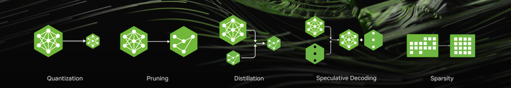

<div align="center">



# NVIDIA Model Optimizer

[](https://nvidia.github.io/Model-Optimizer)
[](https://pypi.org/project/nvidia-modelopt/)
[](./LICENSE)

[官方文档](https://nvidia.github.io/Model-Optimizer) |
[路线图](https://github.com/NVIDIA/Model-Optimizer/issues/1699) |
[发布博客](https://nvidia.github.io/Model-Optimizer/#announcements)

[English](./README.md) | **简体中文**

</div>

______________________________________________________________________

**NVIDIA Model Optimizer**（简称 **Model Optimizer** 或 **ModelOpt**）是一个集成了业界前沿（SOTA）模型优化[技术](#优化技术)的算法库，包含量化（Quantization）、剪枝（Pruning）、神经架构搜索（NAS）、知识蒸馏（Distillation）、投机解码（Speculative Decoding）以及稀疏化（Sparsity），旨在全方位加速模型推理。

**[输入格式]** Model Optimizer 当前支持接入 [Hugging Face](https://huggingface.co/)、[PyTorch](https://github.com/pytorch/pytorch) 或 [ONNX](https://github.com/onnx/onnx) 格式的模型。

**[执行优化]** Model Optimizer 提供了精炼易用的 Python API，方便用户灵活组合上述各项模型优化技术，并导出经过优化的高性能量化检查点（Checkpoint）。
Model Optimizer 还与 [NVIDIA Megatron-Bridge](https://github.com/NVIDIA-NeMo/Megatron-Bridge)、[Megatron-LM](https://github.com/NVIDIA/Megatron-LM) 以及 [Hugging Face Accelerate](https://github.com/huggingface/accelerate) 深度集成，支持需要训练介入的推理优化流程。

**[导出部署]** 深度融入 NVIDIA AI 软件生态，经 Model Optimizer 生成的量化检查点可直接无缝部署到下游主流推理框架中，例如 [SGLang](https://github.com/sgl-project/sglang)、[TensorRT-LLM](https://github.com/NVIDIA/TensorRT-LLM/tree/main/examples/quantization)、[TensorRT](https://github.com/NVIDIA/TensorRT) 或 [vLLM](https://github.com/vllm-project/vllm)。统一的 Hugging Face 导出 API 现已同时全面支持 Transformers 与 Diffusers 模型架构。

## 最新动态

- [2026/10/15] [NVIDIA Nemotron 3.5 Super VL 120B-A12B NVFP4 检查点](https://huggingface.co/nvidia/NVIDIA-Nemotron-3.5-Super-VL-120B-A12B-NVFP4)：使用 Model Optimizer 通过训练后量化（PTQ）与量化感知蒸馏（QAD）完成量化。技术细节请参阅[技术报告](https://research.nvidia.com/labs/nemotron/files/NVIDIA-Nemotron-3.5-Super-and-Lightning-Technical-Report.pdf)第 4 节（量化部分）。
- [2026/10/08] [技术博客：AutoQuant KV：自动混合精度 KV 缓存量化](https://nvidia.github.io/Model-Optimizer/announcements/20261008-autoquant-kv.html)：逐层 KV 格式搜索、GEMM 组合优化以及 Qwen3-8B 精度评估实战案例。
- [2026/09/16] [技术博客：Scale Learning：通过训练 NVFP4 块缩放因子恢复模型精度](https://nvidia.github.io/Model-Optimizer/announcements/20260916-scale-learning.html)
- [2026/09/16] [**Qwen3.6-35B-A3B 端到端 W4A4 NVFP4 + QAD 完整教程**](./examples/megatron_bridge/tutorials/Qwen3.6-35B-A3B)：包含 NVFP4 W4A4 PTQ 与量化感知蒸馏，在 vLLM 上相比 BF16 获得最高 1.30x 的吞吐提升，模型体积减少 3.1x，并完整弥合 W4A4 带来的精度损耗。
- [2026/09/09] [技术博客：借助局部海森矩阵（Local-Hessian）权重缩放提升 NVFP4 精度](https://nvidia.github.io/Model-Optimizer/announcements/20260909-local-hessian.html)
- [2026/08/24] [技术博客：AutoQuantize：高速自动混合精度分配算法](https://nvidia.github.io/Model-Optimizer/announcements/20260824-autoquantize.html)
- [2026/08/17] [技术博客：使用 NVIDIA Model Optimizer 基于 QAD 打造 Nemotron 3.5 Lightning NVFP4](https://developer.nvidia.com/blog/developing-nemotron-3-5-lightning-nvfp4-with-qad-using-nvidia-model-optimizer/)：了解量化感知蒸馏如何在激进的 NVFP4 量化下恢复精度的同时，缩减模型尺寸并大幅提升吞吐量。
- [2026/06/26] [技术博客：使用 NVIDIA Model Optimizer 构建 NVIDIA Nemotron 3 Ultra NVFP4 检查点](https://developer.nvidia.com/blog/creating-the-nvidia-nemotron-3-ultra-nvfp4-checkpoint-with-nvidia-model-optimizer/)：详解如何使用 Model Optimizer 将 Nemotron 3 Ultra（550B）量化为 NVFP4——在解码密集型推理中相比 GLM-5.1 754B FP4 获得高达 5.9× 的吞吐提升，同时精度与 BF16 相当。[NVFP4 检查点](https://huggingface.co/nvidia/NVIDIA-Nemotron-3-Ultra-550B-A55B-NVFP4) 已在 Hugging Face 提供。
- [2026/05/27] [**Nemotron-3-Nano-30B-A3B 端到端优化教程**](./examples/megatron_bridge/tutorials/NVIDIA-Nemotron-3-Nano-30B-A3B-BF16)：剪枝 + 两阶段蒸馏 + FP8 量化，实现 2.6× 的 vLLM 推理吞吐提升与 2.6× 的显存占用缩减。
- [2026/05/13] [**Puzzletron**](./examples/puzzletron)：一种面向 LLM 和 VLM 模型异构剪枝与神经架构搜索（NAS）的全新算法。
- [2026/04/15] 客户案例：[Domyn 使用 ModelOpt 的 Minitron 剪枝 + 蒸馏技术将 Colosseum-355B 压缩至 260B](https://www.domyn.com/blog/domyn-large-the-journey-of-a-european-sovereign-ai-model-for-regulated-industries)
- [2026/03/17] 客户案例：[Bielik.AI 使用 ModelOpt 的 Minitron 剪枝 + 蒸馏技术构建 Bielik Minitron 7B（体积减小 33%，速度提升 50%，保持 90% 质量）](https://bielik.ai/en/nvidia-gtc-bielik-minitron-premiere/)
- [2026/03/11] 经 Model Optimizer 量化的 Nemotron-3-Super 检查点现已在 Hugging Face 开放下载：[FP8](https://huggingface.co/nvidia/NVIDIA-Nemotron-3-Super-120B-A12B-FP8)、[NVFP4](https://huggingface.co/nvidia/NVIDIA-Nemotron-3-Super-120B-A12B-NVFP4)。详情请查阅 [Nemotron 3 Super 发布博客](https://blogs.nvidia.com/blog/nemotron-3-super-agentic-ai/)。了解如何量化 Nemotron 3 模型以加速部署，请参阅[此处指南](./examples/hf_ptq/README.md)。
- [2026/03/11] [NeMo Megatron Bridge](https://github.com/NVIDIA-NeMo/Megatron-Bridge) 现已支持利用 Model Optimizer 库执行 Nemotron-3-Super 量化（PTQ 与 QAT）与导出流程。FP8/NVFP4 量化与 HF 导出说明请参阅[量化指南（PTQ 与 QAT）](https://github.com/NVIDIA-NeMo/Megatron-Bridge/blob/super-v3/docs/models/llm/nemotron3-super.md#quantization-ptq-and-qat)。
- [2025/12/11] [技术博客：实现更快、更智能推理的五大 AI 模型优化技术](https://developer.nvidia.com/blog/top-5-ai-model-optimization-techniques-for-faster-smarter-inference/)
- [2025/12/08] NVIDIA TensorRT Model Optimizer 正式品牌升级更名为 NVIDIA Model Optimizer。
- [2025/10/07] [技术博客：使用 NVIDIA Model Optimizer 进行大语言模型剪枝与蒸馏](https://developer.nvidia.com/blog/pruning-and-distilling-llms-using-nvidia-tensorrt-model-optimizer/)
- [2025/09/17] [技术博客：通过投机解码降低 AI 推理延迟入门指南](https://developer.nvidia.com/blog/an-introduction-to-speculative-decoding-for-reducing-latency-in-ai-inference/)
- [2025/09/11] [技术博客：量化感知训练如何助力低精度模型恢复精度](https://developer.nvidia.com/blog/how-quantization-aware-training-enables-low-precision-accuracy-recovery/)
- [2025/08/29] [技术博客：借助量化感知训练微调 gpt-oss 兼顾精度与性能](https://developer.nvidia.com/blog/fine-tuning-gpt-oss-for-accuracy-and-performance-with-quantization-aware-training/)
- [2025/08/01] [技术博客：通过训练后量化优化大语言模型的性能与精度](https://developer.nvidia.com/blog/optimizing-llms-for-performance-and-accuracy-with-post-training-quantization/)
- [2025/06/24] [技术博客：介绍用于高效精准低精度推理的 NVFP4](https://developer.nvidia.com/blog/introducing-nvfp4-for-efficient-and-accurate-low-precision-inference/)
- [2025/05/14] [NVIDIA TensorRT 为 NVIDIA Blackwell GeForce RTX 50 系列 GPU 解锁 FP4 图像生成加速](https://developer.nvidia.com/blog/nvidia-tensorrt-unlocks-fp4-image-generation-for-nvidia-blackwell-geforce-rtx-50-series-gpus/)
- [2025/04/21] [Adobe 借助 Model-Optimizer + TensorRT 优化部署，扩散模型延迟降低 60%，总拥有成本（TCO）降低 40%](https://developer.nvidia.com/blog/optimizing-transformer-based-diffusion-models-for-video-generation-with-nvidia-tensorrt/)
- [2025/04/05] [NVIDIA 加速 Meta Llama 4 Scout 与 Maverick 推理](https://developer.nvidia.com/blog/nvidia-accelerates-inference-on-meta-llama-4-scout-and-maverick/)。如何量化 Llama 4 请参阅[支持矩阵](./examples/hf_ptq/README.md#support-matrix)。
- [2025/03/18] [基于 Blackwell FP4 打造全球最快 DeepSeek-R1 推理，并显著提升 Blackwell 上的图像生成效率](https://developer.nvidia.com/blog/nvidia-blackwell-delivers-world-record-deepseek-r1-inference-performance/)
- [2025/02/25] Model Optimizer 量化的 NVFP4 模型已在 Hugging Face 开放下载：[DeepSeek-R1-FP4](https://huggingface.co/nvidia/DeepSeek-R1-FP4)、[Llama-3.3-70B-Instruct-FP4](https://huggingface.co/nvidia/Llama-3.3-70B-Instruct-FP4)、[Llama-3.1-405B-Instruct-FP4](https://huggingface.co/nvidia/Llama-3.1-405B-Instruct-FP4)
- [2025/01/28] Model Optimizer 正式支持 NVFP4。NVFP4 PTQ 示例请参阅[此处](./examples/hf_ptq/README.md#getting-started)。
- [2025/01/28] Model Optimizer 正式开源！

<details close>
<summary>历史动态</summary>

- [2024/10/23] Model Optimizer 量化的 FP8 Llama-3.1 Instruct 模型已在 Hugging Face 开放下载：[8B](https://huggingface.co/nvidia/Llama-3.1-8B-Instruct-FP8)、[70B](https://huggingface.co/nvidia/Llama-3.1-70B-Instruct-FP8)、[405B](https://huggingface.co/nvidia/Llama-3.1-405B-Instruct-FP8)。
- [2024/09/10] [使用 NVIDIA NeMo 与 Model Optimizer 对大语言模型进行训练后量化](https://developer.nvidia.com/blog/post-training-quantization-of-llms-with-nvidia-nemo-and-nvidia-tensorrt-model-optimizer/)。
- [2024/08/28] [在 NVIDIA H200 GPU 上使用 Model Optimizer 将 Llama 3.1 405B 性能最高提升 44%](https://developer.nvidia.com/blog/boosting-llama-3-1-405b-performance-by-up-to-44-with-nvidia-tensorrt-model-optimizer-on-nvidia-h200-gpus/)
- [2024/08/28] [借助 Medusa 将 Llama 3.1 性能提升最高达 1.9 倍](https://developer.nvidia.com/blog/low-latency-inference-chapter-1-up-to-1-9x-higher-llama-3-1-performance-with-medusa-on-nvidia-hgx-h200-with-nvlink-switch/)
- [2024/08/15] 近期版本新特性：[Cache Diffusion](./examples/diffusers/cache_diffusion)、[基于 NVIDIA NeMo 的 QLoRA 工作流](https://docs.nvidia.com/nemo-framework/user-guide/24.09/sft_peft/qlora.html)等。详情请阅读[博客文章](https://developer.nvidia.com/blog/nvidia-tensorrt-model-optimizer-v0-15-boosts-inference-performance-and-expands-model-support/)。
- [2024/06/03] 作为支持主流部署框架努力的一部分，Model Optimizer 新增了面向 vLLM 部署的实验性功能。具体工作流请参阅[此处](./examples/hf_ptq/README.md#vllm)
- [2024/05/08] [官方发布：Model Optimizer 正式上线，进一步提升生成式 AI 推理性能](https://developer.nvidia.com/blog/accelerate-generative-ai-inference-performance-with-nvidia-tensorrt-model-optimizer-now-publicly-available/)
- [2024/03/27] [Model Optimizer 助力 TensorRT-LLM 创下 MLPerf LLM 推理新纪录](https://developer.nvidia.com/blog/nvidia-h200-tensor-core-gpus-and-nvidia-tensorrt-llm-set-mlperf-llm-inference-records/)
- [2024/03/18] [GTC 专题演讲：在 TensorRT-LLM 和 TensorRT 中利用量化技术优化生成式 AI 推理](https://www.nvidia.com/en-us/on-demand/session/gtc24-s63213/)
- [2024/03/07] [Model Optimizer 的 8 位训练后量化技术帮助 TensorRT 将 Stable Diffusion 性能加速近 2 倍](https://developer.nvidia.com/blog/tensorrt-accelerates-stable-diffusion-nearly-2x-faster-with-8-bit-post-training-quantization/)
- [2024/02/01] [在 TRT-LLM 中使用 Model Optimizer 量化技术加速推理](https://github.com/NVIDIA/TensorRT-LLM/blob/main/docs/source/blogs/quantization-in-TRT-LLM.md)

</details>

## 安装指南

使用 `pip` 从 [PyPI](https://pypi.org/project/nvidia-modelopt/) 安装 Model Optimizer 稳定版软件包：

```bash
pip install -U nvidia-modelopt[all]
```

Model Optimizer 在安装过程中会下载并安装额外的第三方开源软件项目。使用前请仔细查阅这些开源项目的许可证条款。

如需以包含全部开发依赖的可编辑模式从源码安装，或体验最新特性，请运行：

```bash
# 克隆 Model Optimizer 仓库
git clone git@github.com:NVIDIA/Model-Optimizer.git
cd Model-Optimizer

pip install -e .[dev]
```

您也可以直接使用已预装 Model Optimizer 的 NVIDIA 官方容器镜像：

- `nvcr.io/nvidia/pytorch:<version>-py3`
- `nvcr.io/nvidia/nemo:<version>`
- `nvcr.io/nvidia/tensorrt-llm/release:<version>`

在拉取并使用这些容器镜像前，请仔细阅读各自的许可证条款。
请按照上述说明将 Model Optimizer 升级至最新版本。
如需更精细化地控制安装依赖，或了解备用 Docker 镜像与环境变量配置，请参阅[安装指南](https://nvidia.github.io/Model-Optimizer/getting_started/2_installation.html)。

## 优化技术

<div align="center">

| **优化技术** | **功能描述** | **快速入门** | **实战示例** |
| :------------: | :------------: | :------------: | :------------: |
| 训练后量化 (PTQ) | 将模型体积压缩 2x-4x，在保持模型精度的同时大幅提升推理速度！ | \[[入门指引](https://nvidia.github.io/Model-Optimizer/guides/1_quantization.html)\] | \[[HF LLMs / VLMs](./examples/hf_ptq/)\] \[[Megatron-Bridge LLMs / VLMs](./examples/megatron_bridge/README.md#post-training-quantization)\] \[[Diffusers](./examples/diffusers/)\] \[[ONNX](./examples/onnx_ptq/)\] \[[Windows](./examples/windows/)\] |
| 量化感知训练 / 蒸馏 (QAT/QAD) | 仅需极少训练步数，即可进一步挽回量化模型的精度损失！ | \[[入门指引](https://nvidia.github.io/Model-Optimizer/guides/quantization_aware_training_and_distillation.html)\] | \[[Hugging Face](./examples/llm_qat/)\] \[[Megatron-Bridge](./examples/megatron_bridge/README.md#quantization-aware-distillation-qad)\] |
| 剪枝 (Pruning) | 剔除冗余权重，缩减模型参数量与显存占用并加速推理！ | \[[入门指引](./examples/pruning/README.md)\] | \[[通用](./examples/pruning/)\] \[[Megatron-Bridge](./examples/megatron_bridge/README.md#pruning)\] |
| 知识蒸馏 (Distillation) | 通过让小模型学习大模型的输出行为，大幅缩减部署模型体积！ | \[[入门指引](https://nvidia.github.io/Model-Optimizer/guides/4_distillation.html)\] | \[[Hugging Face](./examples/llm_distill/)\] \[[Megatron-Bridge](./examples/megatron_bridge/README.md#distillation)\] \[[Megatron-LM](./examples/llm_distill/README.md#knowledge-distillation-kd-in-nvidia-megatron-lm-framework)\] |
| 投机解码 (Speculative Decoding) | 训练轻量草稿模块，在推理期间预测后续 Token 实现加速！ | \[[入门指引](https://nvidia.github.io/Model-Optimizer/guides/5_speculative_decoding.html)\] | \[[Hugging Face](./examples/speculative_decoding/)\] \[[Megatron-LM](./examples/speculative_decoding#mlm-example)\] |
| 稀疏化 (Sparsity) | 仅存储非零参数值及其位置索引，实现对模型的高效压缩 | \[[入门指引](https://nvidia.github.io/Model-Optimizer/guides/6_sparsity.html)\] | \[[Hugging Face](./examples/llm_sparsity/)\] |

</div>

## 预量化权重

- 开箱即用的预量化模型权重 \[[🤗 Hugging Face - Nvidia Model Optimizer 官方集合](https://huggingface.co/collections/nvidia/inference-optimized-checkpoints-with-model-optimizer)\]
- 可直接部署至 [TensorRT-LLM](https://github.com/NVIDIA/TensorRT-LLM)、[vLLM](https://github.com/vllm-project/vllm) 和 [SGLang](https://github.com/sgl-project/sglang)
- 更多模型即将陆续上线！

## 常用资源

- 📅 [开发路线图](https://github.com/NVIDIA/Model-Optimizer/issues/1699)
- 📖 [官方文档中心](https://nvidia.github.io/Model-Optimizer)
- 🎯 [基准测试评测](./examples/benchmark.md)
- 💡 [版本更新日志](https://nvidia.github.io/Model-Optimizer/reference/0_changelog.html)
- 🐛 [提交缺陷报告 (Bug Report)](https://github.com/NVIDIA/Model-Optimizer/issues/new?template=1_bug_report.md)
- ✨ [提交新功能建议 (Feature Request)](https://github.com/NVIDIA/Model-Optimizer/issues/new?template=2_feature_request.md)

## 模型支持矩阵

| 模型类型 | 支持矩阵链接 |
|------------|----------------|
| LLM / VLM 量化 | [查看支持矩阵](./examples/hf_ptq/README.md#support-matrix) |
| Diffusers 扩散模型量化 | [查看支持矩阵](./examples/diffusers/README.md#support-matrix) |
| ONNX 量化 | [查看支持矩阵](./examples/torch_onnx/README.md#supported-models) |
| Windows 量化 | [查看支持矩阵](./examples/windows/README.md#support-matrix) |
| 量化感知训练 (QAT) | [查看支持矩阵](./examples/llm_qat/README.md#support-matrix) |
| 剪枝 (Pruning) | [查看支持矩阵](./examples/pruning/README.md#support-matrix) |
| 知识蒸馏 (Distillation) | [查看支持矩阵](./examples/llm_distill/README.md#support-matrix) |
| 投机解码 (Speculative Decoding) | [查看支持矩阵](./examples/speculative_decoding/README.md#support-matrix) |

## 弃用政策

Model Optimizer 遵循规范化的弃用机制来管理废弃特性：

- **公告传达：** 弃用通知会在[更新日志](https://nvidia.github.io/Model-Optimizer/reference/0_changelog.html)中记录。被弃用的组件在源码中包含废弃时间说明，并在调用时触发运行时告警。
- **迁移缓冲期：** 在 Model Optimizer 正式进入 1.0 之前，弃用后提供为期 1 个版本（约 1 个月）的迁移缓冲期。在此期间，废弃特性仍可正常运行并伴随警告提示。
- **覆盖范围：** 该政策同时适用于完整弃用（移除整套 API）与部分弃用（移除方法内的特定参数）。
- **正式移除：** 迁移期结束后，废弃元素将严格按照语义化版本规范移除，在 0.x 阶段的次版本更新中可能包含不兼容变更。

## 引用

如果您在学术研究中使用了 NVIDIA Model Optimizer，欢迎按如下格式进行引用：

```bibtex
@misc{nvidia-modelopt,
  author       = {{NVIDIA Corporation}},
  title        = {{NVIDIA Model Optimizer}},
  howpublished = {\url{https://github.com/NVIDIA/Model-Optimizer}},
  year         = {2024--2026},
  note         = {GitHub repository}
}
```

## 参与贡献

Model Optimizer 现已全面开源！我们非常欢迎任何反馈、功能建议和 Pull Request。
详细的贡献流程与规范请参阅我们的[贡献指南](./CONTRIBUTING.md)。

## AI 智能体集成

ModelOpt 的智能体技能（Agent Skills）可直接从本仓库安装，并在任何工作区中使用。

### Claude Code

```bash
claude plugin marketplace add https://github.com/NVIDIA/Model-Optimizer.git
claude plugin install modelopt@modelopt
```

### Codex

```bash
codex plugin marketplace add https://github.com/NVIDIA/Model-Optimizer.git
```

随后打开 `/plugins`，选择 `modelopt` 市场并安装 `modelopt`。
贡献者也可以直接在本地克隆代码库中使用这些技能，详情请参阅[智能体工具链说明](./.agents/TOOLING.md)。

### 核心贡献者

[](https://github.com/NVIDIA/Model-Optimizer/graphs/contributors)

祝优化愉快！

---

> _注：本简体中文文档由社区志愿者翻译维护。若与英文原版存在差异，请以 [README.md](README.md) 为准。_
