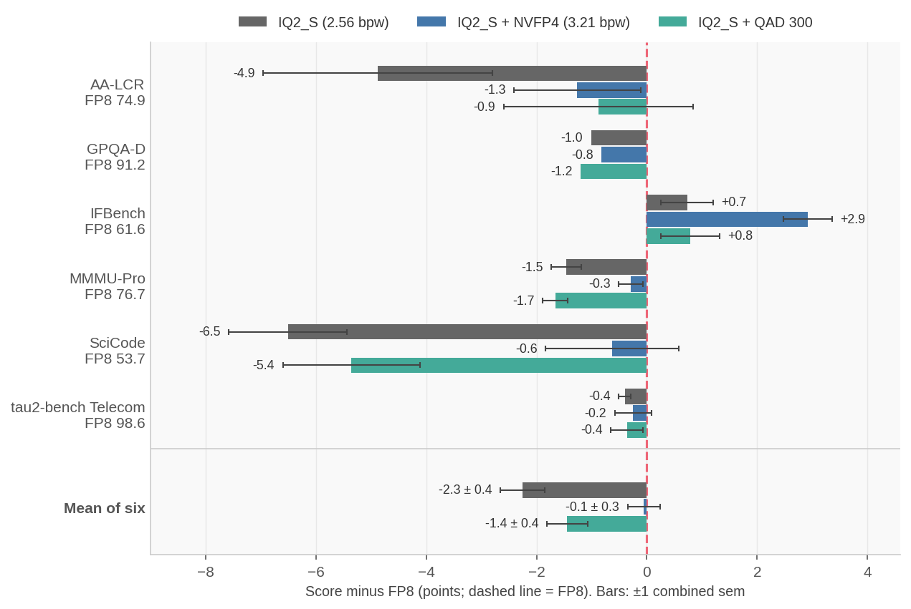
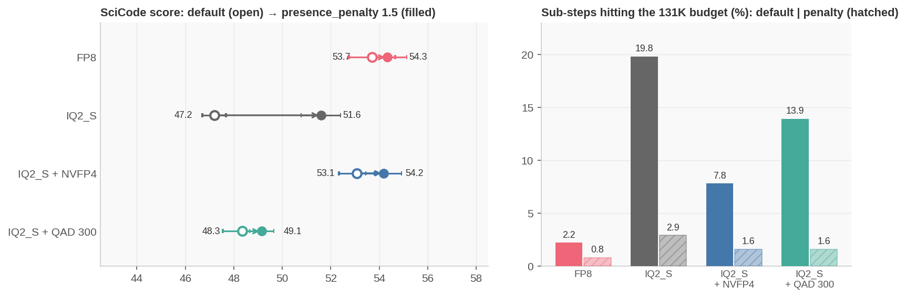
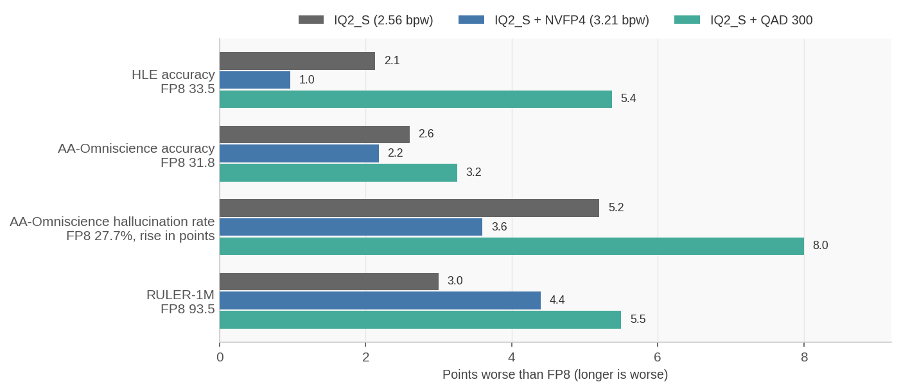
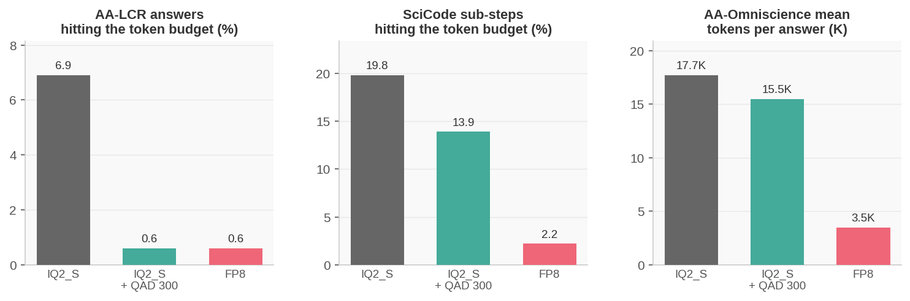
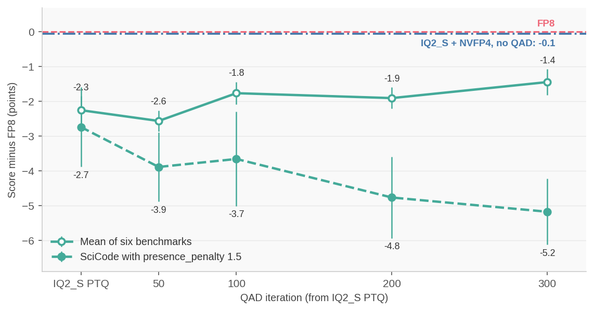
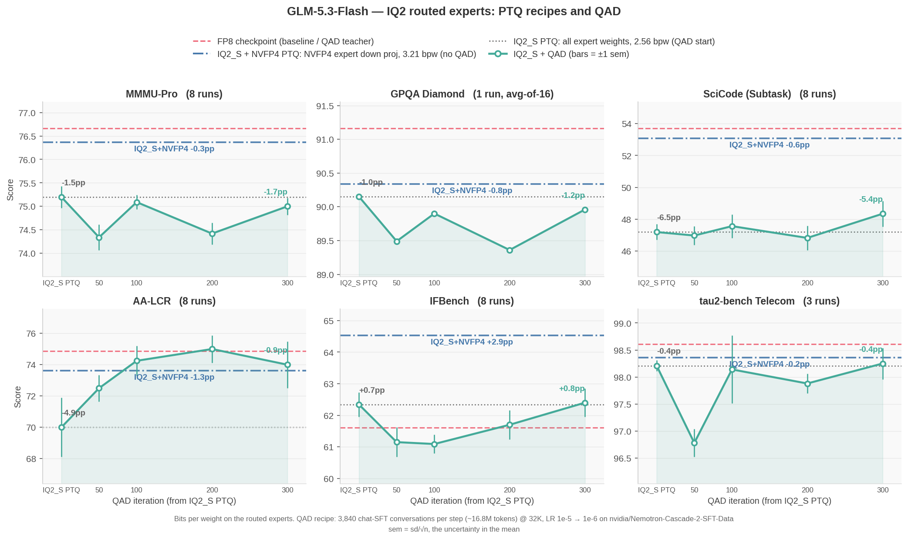
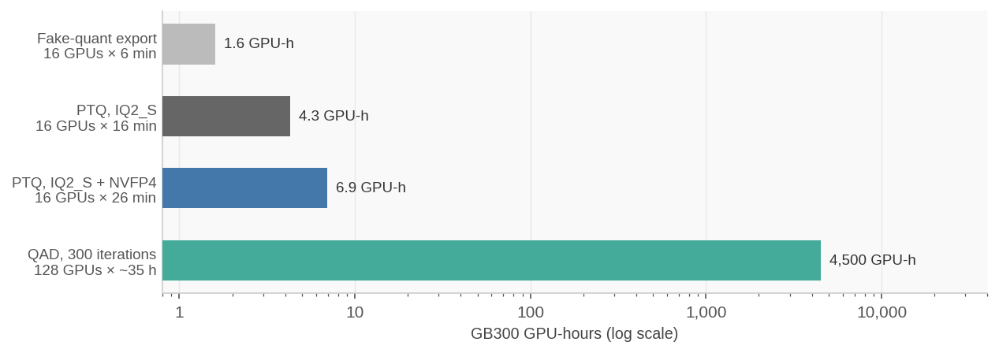

:orphan:

GLM-5.3-Flash at 2-3 Bits per Expert Weight: IQ2_S PTQ Recipes and QAD
######################################################################

:Author: Model Optimizer Team
:Date: October 28, 2026
:Tags: quantization, ggml, iq2, nvfp4, gptq, qad, megatron-bridge

GLM-5.3-Flash is a 321B-parameter MoE, and 304B of those parameters are its 288 routed experts. We
quantized the routed experts to GGML IQ2_S (2.56 bits per weight) with layerwise GPTQ in
Megatron-Bridge. We then tried Quantization-Aware Distillation (QAD) to recover what PTQ lost.
With our current data blend, QAD brought AA-LCR back to the FP8 score and cut runaway generations,
closing over a third of the gap on the six-benchmark mean, but it did not yet restore knowledge
recall. A small recipe change recovered nearly all of the gap without any training: NVFP4 on the
experts' down projections.

We publish both recipes as alternatives: **IQ2_S**, IQ2_S on every routed-expert weight, for the
smallest model, and **IQ2_S + NVFP4**, with NVFP4 on the experts' down projections, for accuracy at
the level of the FP8 checkpoint.

.. note::

   **The baseline is FP8, not BF16.** Every delta below is against the FP8 release,
   ``zai-org/GLM-5.3-Flash``, not the BF16 checkpoint. Both recipes quantize starting from those FP8
   weights (dequantized to BF16), and the same FP8 model is the QAD teacher.

Highlights
**********

* **IQ2_S + NVFP4 matches FP8 with no training.** Over six benchmarks its mean is within 0.1
  points of FP8, and no benchmark is measurably below it. Its routed experts use 3.21 bits per
  weight: IQ2_S for gate and up, weight-only NVFP4 for down.
* **IQ2_S is 25 GB smaller** (2.56 bits per weight on every routed-expert weight) and costs 2.3
  points on the mean. Most of that loss is on SciCode and AA-LCR, where generations run 2-3x
  longer than FP8's and more often hit the token budget.
* **QAD fixes long-context runaways.** 300 QAD iterations on the IQ2_S model took AA-LCR from
  70.0 to 74.0 (FP8 74.9), cut its answers that hit the token budget from 6.9% to 0.6%, and moved
  the mean from 2.3 to 1.4 points below FP8. Knowledge recall did not recover with our current data
  blend, a general chat-SFT mix reused from Qwen3.6, so a blend chosen for GLM-5.3-Flash may do
  better. Since IQ2_S + NVFP4 already matches FP8 without training, we recommend the PTQ recipes
  today.
* **The down projections carry most of the IQ2 error.** Moving only them to NVFP4 (+0.65 bits per
  weight on the experts) cut per-token NLL error against FP8 by ~40% and closed the accuracy gap.

The Two Recipes
***************

.. list-table::
   :header-rows: 1
   :widths: 26 25 25 24

   * -
     - FP8 checkpoint
     - IQ2_S
     - IQ2_S + NVFP4
   * - Routed experts (304B parameters)
     - FP8
     - IQ2_S
     - IQ2_S gate/up, NVFP4 down
   * - Routed-expert bits per weight
     - 8
     - 2.56
     - 3.21
   * - Model size
     - 328 GB
     - ~130 GB (2.5x smaller)
     - ~155 GB (2.1x smaller)
   * - Mean delta vs FP8, six benchmarks
     - –
     - −2.3 ± 0.4
     - **−0.1 ± 0.3**
   * - Weight formats
     - FP8
     - GGML only (IQ2_S, Q8_0)
     - GGML (IQ2_S, Q8_0) + NVFP4

Both recipes keep shared experts and the dense MLP of layers 0-2 in Q8_0. Attention (KDA and sparse
MLA), the router, the vision tower, the MTP layer, embeddings and lm_head stay in BF16. Model sizes
are computed from the bits per weight of each tensor, including the BF16 MTP layer and the vision
tower. FP8 is the size on disk. At ~130-155 GB, either quantized model's weights fit on one 288 GB
GB300 GPU, while the FP8 weights need two.

Every quantized evaluation here served a *fake-quant* export: the IQ2 and NVFP4 weights decoded
back to BF16. That makes the accuracy exact, but the model is as large and as fast as BF16. To
serve IQ2_S smaller, export it without ``--vllm_fakequant_export`` and convert that GGML checkpoint with
`convert_ggml_to_int8.py <https://github.com/NVIDIA/Model-Optimizer/blob/main/examples/hf_ptq/convert_ggml_to_int8.py>`__
into an INT8 weight-only checkpoint that vLLM serves directly. On one GB300 node (TP4) it matched
the fake-quant export within 0.0013 nats per token and held 86 instead of 148 GiB of weights per
GPU. With vLLM's Humming kernels (``--moe-backend humming`` and
``VLLM_DISABLED_KERNELS=MarlinLinearKernel``) it generated 0.98x the fake-quant tokens per second at
64 prompts and 0.83x at 512 (1K tokens in, 4K out); vLLM's default MoE kernel for it was 3-4x
slower. IQ2_S + NVFP4 has no such path yet: the converter does not handle NVFP4 layers.

Accuracy
********

**Figure 1. Score difference from FP8, per benchmark and on the mean.** IQ2_S + NVFP4 (blue) is
within about one standard error of FP8 everywhere except IFBench, where it is 2.9 points higher.
IQ2_S (grey) loses most on SciCode and AA-LCR. Bars are ±1 combined sem (none for GPQA-D, one run
of 16 repeats).

The ± on a mean delta combines the per-benchmark sems of both models (GPQA-D adds none). All
evaluations use a 131K-token generation budget and a BF16 KV cache, served by vLLM 0.31 with
prefix caching on. vLLM 0.31 fixes a GLM-5.3-Flash prefix-caching bug that lowers long-context
scores on earlier versions; with caching off, FP8 AA-LCR moves by 1.2 points (76.1 ± 0.8 vs
74.9 ± 0.9, 8 runs each), within noise.

.. toggle::

   **Full table** (``mean ± sem``; run count in brackets)

   .. list-table::
      :header-rows: 1
      :widths: 24 19 19 19 19

      * - Benchmark (runs)
        - FP8
        - IQ2_S
        - **IQ2_S + NVFP4**
        - IQ2_S + QAD 300
      * - AA-LCR (8)
        - 74.9 ± 0.9
        - 70.0 ± 1.9
        - **73.6 ± 0.8**
        - 74.0 ± 1.5
      * - GPQA-D (16 repeats)
        - 91.2
        - 90.2
        - **90.3**
        - 90.0
      * - IFBench (8)
        - 61.6 ± 0.3
        - 62.3 ± 0.4
        - **64.5 ± 0.3**
        - 62.4 ± 0.5
      * - MMMU-Pro (8)
        - 76.7 ± 0.1
        - 75.2 ± 0.2
        - **76.4 ± 0.2**
        - 75.0 ± 0.2
      * - SciCode (8)
        - 53.7 ± 1.0
        - 47.2 ± 0.5
        - **53.1 ± 0.7**
        - 48.3 ± 0.8
      * - tau2-bench Telecom (3)
        - 98.6 ± <0.1
        - 98.2 ± 0.1
        - **98.4 ± 0.3**
        - 98.3 ± 0.3
      * - **Mean delta vs FP8**
        - –
        - −2.3 ± 0.4
        - **−0.1 ± 0.3**
        - −1.4 ± 0.4
      * - SciCode, ``presence_penalty`` 1.5 (8)
        - 54.3 ± 0.8
        - 51.6 ± 0.8
        - **54.2 ± 0.7**
        - 49.2 ± 0.5
      * - SciCode sub-steps hitting the token budget
        - 2.2%
        - 19.8%
        - 7.8%
        - 13.9%

**The loss is mostly runaway generation.** IQ2 makes the model loop: it re-derives finished
answers until it reaches the token budget and returns nothing. A ``presence_penalty`` of 1.5 at
decode time cuts IQ2_S's capped SciCode sub-steps from 19.8% to 2.9% and recovers 4.4 points. Compare
penalized runs only with a penalized FP8, since the penalty also helps FP8 (+0.6).

**Figure 2. SciCode with and without** ``presence_penalty`` **1.5.** Left: score, default (open)
and with the penalty (filled), ±1 sem over 8 runs. Right: share of sub-steps that hit the 131K-token
budget.

Knowledge Recall and Long Context
*********************************

Six-benchmark suites like the one above can miss what very low-bit quantization loses most:
stored facts. We added HLE (text-only, 2,158 questions, GPT-4o judge), AA-Omniscience (600
questions x 10 repeats, Gemini 3 Flash judge) and RULER at 1M tokens (13 subtasks, 25 samples
each).

**Figure 3. Knowledge recall and long context, in points worse than FP8.** For the hallucination
rate, the bar is the rise over FP8's 27.7%. HLE has a standard error of ~1.0 per model, and
RULER-1M ~1.5.

.. toggle::

   **Full table**

   .. list-table::
      :header-rows: 1
      :widths: 32 17 17 17 17

      * -
        - FP8
        - IQ2_S
        - IQ2_S + NVFP4
        - IQ2_S + QAD 300
      * - HLE accuracy
        - 33.5
        - 31.4
        - 32.5
        - 28.1
      * - AA-Omniscience accuracy
        - 31.8
        - 29.2
        - 29.6
        - 28.5
      * - AA-Omniscience hallucination rate
        - 27.7%
        - 32.9%
        - 31.3%
        - 35.7%
      * - RULER-1M
        - 93.5
        - 90.5
        - 89.1
        - 88.0

**Both recipes lose ~2.2-2.6 points of AA-Omniscience accuracy and hallucinate 4-5 points more
often.** This is the one place IQ2_S + NVFP4 does not reach FP8: NVFP4 on the down projections
helps HLE (−1.0 vs −2.1) but barely moves AA-Omniscience. The hallucination rate is
incorrect / (incorrect + abstained), so a rising rate means the model guesses where FP8 declined
to answer.

**QAD with the current data blend did not recover recall.** Against the IQ2_S model it started
from, QAD 300 lost a further 3.2 points on HLE (~2.3 standard errors) and traded abstentions for
wrong answers on AA-Omniscience. It also did not recover RULER-1M. The blend is general chat SFT
chosen for Qwen3.6, with no data aimed at stored facts, abstention or million-token contexts, so it
may not be the best blend for GLM-5.3-Flash. We saw the same calibration loss after QAD on
Qwen3.6-35B-A3B with the same blend.

What QAD Did
************

QAD trained the IQ2_S model against the FP8 teacher on Nemotron-Cascade-2 chat-SFT data, the
`Qwen3.6 tutorial's
<https://github.com/NVIDIA/Model-Optimizer/tree/main/examples/megatron_bridge/tutorials/Qwen3.6-35B-A3B>`__
blend re-tokenized for GLM. It packed conversation pairs into 32K sequences with loss on assistant
tokens only, 3,840 conversations (~16.8M tokens) per step, top-4096 logit KL, and learning rate
1e-5 → 1e-6 over a 500-iteration cosine schedule.

**Where QAD helps.** It fixes the runaway generations that cost IQ2_S most of its long-context
accuracy, and shortens answers elsewhere:

**Figure 4. Where QAD helps.** QAD 300 matches FP8's AA-LCR runaway rate, cuts SciCode's by 30%
and shortens AA-Omniscience answers. With that, AA-LCR rises from 70.0 ± 1.9 to 74.0 ± 1.5
(FP8 74.9 ± 0.9) and the six-benchmark mean from −2.3 ± 0.4 to −1.4 ± 0.4 points.

**What the current blend does not fix.** On the six-benchmark mean, QAD 300 gains 0.8 ± 0.4 over
IQ2_S, just under two standard errors, and most of that comes in the first 100 iterations:

**Figure 5. QAD progress, as points below FP8.** Solid: mean of the six benchmarks. Dashed: SciCode
with ``presence_penalty`` 1.5, against the penalized FP8. Bars are ±1 combined sem.

After iteration 100 the mean moved by less than the ~0.5-point noise. With the decode-time
penalty in place, every QAD checkpoint trails the PTQ model on SciCode, so on SciCode QAD's gain
comes from fewer runaways, which the penalty also removes. Knowledge recall and RULER-1M did not
recover (see above). On AA-LCR, where the penalty was not tested, QAD's recovery stands on its
own. The next step for QAD is the data: a blend with knowledge-heavy, abstention and long-context
samples, or responses generated by GLM-5.3-Flash itself, instead of a general chat-SFT mix.

Figure 6 follows each benchmark through the QAD run.

**Figure 6. GLM-5.3-Flash accuracy for both recipes and the QAD run.** Each panel follows the IQ2_S
model (x=0) through 300 QAD iterations. The dashed line is the FP8 baseline, the dash-dot line is
IQ2_S + NVFP4 (no QAD) and the dotted line is IQ2_S. Bars are ±1 sem.

What It Costs
*************

On GB300 NVL72:

* **PTQ:** 16 minutes (IQ2_S) to 26 minutes (IQ2_S + NVFP4) on 4 nodes (16 GPUs, EP16),
  including GPTQ on 256 long-reasoning calibration samples of up to 32K tokens.
* **Fake-quant export:** 6 minutes on the same nodes.
* **QAD:** 32 nodes (128 GPUs; EP32, CP4) at ~400 s per iteration once warm, so the 300 iterations
  took about 35 hours of training, or ~4,500 GPU-hours, not counting restarts.

**Figure 7. Compute per step, in GB300 GPU-hours (log scale).**

Reproducing
***********

The steps follow the `Qwen3.6-35B-A3B tutorial
<https://github.com/NVIDIA/Model-Optimizer/tree/main/examples/megatron_bridge/tutorials/Qwen3.6-35B-A3B>`__:
PTQ with ``examples/megatron_bridge/quantize.py``, QAD with ``distill.py``, export with
``export_quantized_megatron_to_hf.py``, and evaluation with NeMo Evaluator. Only the differences for
GLM-5.3-Flash are listed here.

**Software.** GLM-5.3-Flash support is still landing upstream. Start from the ``nemo:26.10``
container and switch two of its checkouts:

* ``/opt/Megatron-Bridge`` to `Megatron-Bridge #6044 <https://github.com/NVIDIA-NeMo/Megatron-Bridge/pull/6044>`__,
  the GLM-5.3-Flash bridge;
* its ``3rdparty/Megatron-LM`` submodule to Megatron-LM main, which has the mHC precision controls
  (`#7521 <https://github.com/NVIDIA/Megatron-LM/pull/7521>`__), with
  `#7054 <https://github.com/NVIDIA/Megatron-LM/pull/7054>`__ (KDA hybrid layers) merged in.

Once Megatron-LM merges #7054, Megatron-Bridge merges #6044 and bumps its Megatron-LM dependency,
updating Megatron-Bridge and that submodule in the container is enough. Install Model Optimizer from
`#2539 <https://github.com/NVIDIA/Model-Optimizer/pull/2539>`__, which adds GLM-5.3-Flash PTQ and
export to Megatron-Bridge and both recipes, until it merges.

**PTQ (IQ2_S; for IQ2_S + NVFP4 use** ``iq2_s_experts-nvfp4_down-q8_0_shared_dense-gptq`` **):**

.. code-block:: bash

   torchrun --nproc_per_node 4 examples/megatron_bridge/quantize.py --skip_generate --no_moe_grouped_gemm \
       --hf_model_name_or_path <glm-5.3-flash-fp8> \
       --recipe models/zai-org/GLM-5.3-Flash-BF16/ptq/iq2_s_experts-q8_0_shared_dense-gptq \
       --tp_size 1 --ep_size 16 --pp_size 1 \
       --calib_dataset_name <long_reasoning_256.jsonl> --calib_num_samples 256 --calib_batch_size 1 \
       --seq_length 32768 --dsa_kernel_backend cudnn \
       --export_megatron_path <ptq_ckpt>

* ``--no_moe_grouped_gemm``: GPTQ and the GGML formats need per-expert linears.
* **Long calibration samples matter.** 256 long-reasoning traces at 32K tokens beat 512 4K-token
  samples. GPQA went from 86.7 to 89.8 and SciCode from 41.1 to 47.2, with fewer runaway
  generations.
* ``--dsa_kernel_backend cudnn``: the unfused sparse-attention fallback builds dense ``[seq, seq]``
  scores and does not fit at 32K.

**Export for evaluation** (vLLM has no IQ2 kernels):

.. code-block:: bash

   torchrun --nproc_per_node 4 examples/megatron_bridge/export_quantized_megatron_to_hf.py \
       --no_moe_grouped_gemm --vllm_fakequant_export --ep_size 16 \
       --hf_model_name_or_path <glm-5.3-flash-fp8> --megatron_path <ptq_ckpt> \
       --export_unified_hf_path <hf_fakequant>

**Evaluation:** serve with vLLM ≥ 0.31, or 0.30 with ``--no-enable-prefix-caching`` (``glm47`` reasoning
and tool parsers, TP4), and use the model card's sampling (temperature 1.0, top_p 0.95; top_p 1.0
for tau2-bench) with ``reasoning_effort: max`` and a 131K generation budget. GLM reasons long: a
32K budget leaves about half of GPQA answers unfinished.

**QAD, if you try it** (differences from the Qwen3.6 command):

* ``--sft --sft_hf_dataset <pairs.jsonl> --sft_in_batch_packing --mbs 2 --moe_aux_loss_coeff 0``:
  with EP > 1, Megatron-Bridge pads every conversation to ``--seq_length``. The MoE load-balancing
  loss on that padding drove the embedding gradient to Inf.
* ``--no_moe_grouped_gemm --freeze_mtp --ep_size 32 --cp_size 4 --recompute_granularity full
  --recompute_method uniform --recompute_num_layers 2 --dsa_kernel_backend cudnn``, plus
  ``NCCL_NVLS_ENABLE=0`` to leave memory for NCCL buffers.
