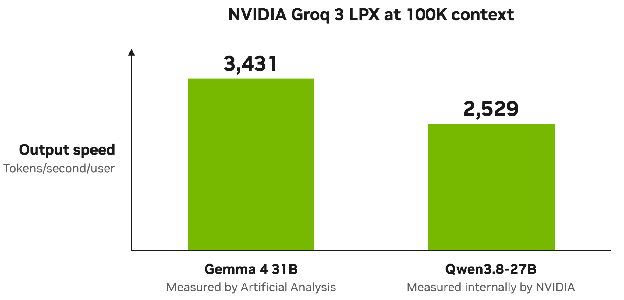
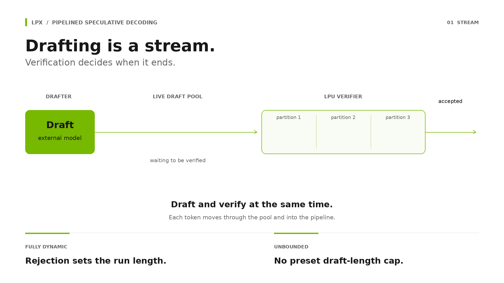
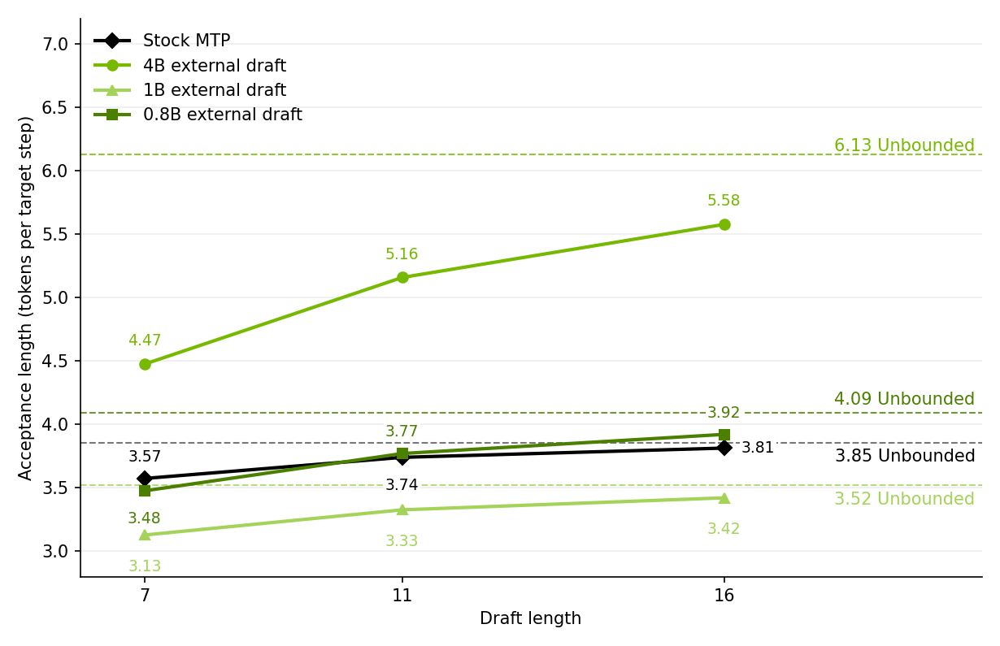

:orphan:

Training Standalone Speculative Decoding Drafts for Fast Inference on Groq 3 LPX
################################################################################

:Author: Peter Hicks, Bear Xiong, Arash Taheri-Dezfouli, Charlie Wang, Seth Weidman, Andrew Ling
:Date: November 12, 2026
:Tags: speculative-decoding, external-draft, groq-lpx, qwen3.8, distillation

Introduction
************

Speculative decoding is an important approach for achieving low-latency inference with large
language models. In traditional speculative decoding, a small, fast draft model produces tokens to
be verified by a larger, slower target model. Recent work has moved away from small standalone draft
architectures and has been focussed extensively on tail-augmented low-latency drafts, such as EAGLE
and MTP heads. These drafts are attached to the target model and conditioned on its hidden states.
These designs are driven by the need to minimize drafting latency via model architecture choices in
traditional GPU systems. In such systems, small parameter count, multilayer, standalone draft
architectures do not necessarily execute proportionally fast enough relative to the target model,
and can incur a significant latency. When drafting and verification run sequentially, this latency
is incurred for every drafted token, leading to a tradeoff between acceptance length and latency.

The introduction of NVIDIA Groq 3 LPX has shifted this tradeoff by lowering the latency of larger,
multi-layer standalone drafts. By deploying these larger draft models, along with the target models,
on NVIDIA Groq 3 LPX, acceptance lengths similar to, and in some cases better than, tail-augmented
drafts can be achieved without sacrificing system latency. Standalone drafts also need only the
target's tokens and probabilities, not its hidden states, which suits a disaggregated system where
the draft and verifier run on separate hardware. Coupled with pipelined verification and parallel
drafting, drafting time can be largely hidden behind verification time, resulting in SOTA
performance in minimum-latency scenarios (see Figure 1).

         NVIDIA
   :width: 100%

**Figure 1. Speed of Groq 3 LPX with 100K input tokens of context length, as measured by Artificial
Analysis and NVIDIA.**

In this report we outline the ultra-low latency NVIDIA Groq 3 LPX speculative decoding system in
more detail. We also describe the process of training external drafts from existing small model
architectures using the ModelOpt library. Further, today we release three new external draft models,
trained for the ``Qwen/Qwen3.8-27B`` target:

- ``nvidia/Qwen3.5-4B-Qwen3.8-27B-Draft``
- ``nvidia/Qwen3.5-0.8B-Qwen3.8-27B-Draft``
- ``nvidia/Llama-3.2-1B-Qwen3.8-27B-Draft``

These models have been distilled using ModelOpt to align the drafts with the target.

LPX Pipelined Speculative Decoding System
*****************************************

The LPX speculative decoding system processes tokens in a pipeline parallel fashion. This pipelining
allows for a unique approach to speculative decoding (see Figure 2). The draft runs as a disaggregated
system, constantly streaming a pool of tokens to be verified. Rather than verifying tokens as a
block in prefill mode, they are verified by streaming through the target model’s pipeline
partitions. The draft streams tokens continuously until the target rejects a token, in which case
the draft system is stopped and continues from the new verification token. This system has two
unique qualities:

- **Fully Dynamic Unbounded Drafting**. The draft length is not fixed, which allows long streaks on
  high-acceptance workloads such as coding.
- **Parallel Drafting and Verification**. The drafting latency is hidden behind the target's
  verification time.

         verifier, which stops the drafter on a rejection
   :width: 100%

**Figure 2. Parallel, fully dynamic unbounded speculative decoding on LPX.**

The fully dynamic unbounded drafting in particular is well suited to external drafts, where it is
observed that the acceptance lengths at longer draft lengths are generally better than
tail-augmented methods. The *Results* section below presents a case study comparing standalone
drafts for deployment on Groq 3 LPX to the model's stock MTP head.

Results
*******

In our study we investigate a Qwen/Qwen3.8-27B target. Against this target we measure acceptance
lengths across three trained standalone drafts, comparing against the model's native MTP as a
baseline. We measure the acceptance length for each draft at various draft lengths. Acceptance
length is the mean number of tokens accepted per target step, at a given draft length, including the
free verification token. All models are measured on the qualitative subset of `nvidia/SPEED-Bench
<https://huggingface.co/datasets/nvidia/SPEED-Bench>`__ (all 880 conversations, first turn of each)
with the same sampling policy (temperature=1, top-k=20, top-p=0.95), under a rejection sampling
acceptance criterion. The MTP head is measured live, and the standalone drafts are scored offline on
the token sequences the target generated in a live MTP run on the same benchmark. The “Unbounded”
line refers to the fully dynamic unbounded drafting technique described in the above section.

         stock MTP head, with dashed lines for unbounded acceptance length
   :width: 100%

**Figure 3. Acceptance length against draft length.** Solid lines are directly measured at draft
lengths 7, 11 and 16. The dashed line for each model is its unbounded acceptance length.

Typically, the acceptance length of MTP drafts is judged at small fixed draft lengths between 1 and
7. For this case study we also measure draft lengths of 11 and 16, and the unbounded case. Figure 3
shows that ``nvidia/Qwen3.5-4B-Qwen3.8-27B-Draft`` outperforms the native MTP at every draft length.
``nvidia/Qwen3.5-0.8B-Qwen3.8-27B-Draft`` is slightly behind the MTP at a draft length of 7 and
ahead of it from 11 onward. ``nvidia/Llama-3.2-1B-Qwen3.8-27B-Draft`` trails the MTP at fixed draft
lengths. The MTP gains little beyond a draft length of 16, while the standalone drafts keep
improving, so the picture shifts at unbounded draft length. ``nvidia/Qwen3.5-4B-Qwen3.8-27B-Draft``
accepts 6.13 tokens against the MTP’s 3.85, an increase of 59%. Qwen3.5-0.8B, at a fifth of the 4B's
parameters, is 6% better than the MTP head. The 1B draft, built from a model with a different
tokenizer, comes within 9% of the MTP at 3.52.

Because the draft and verifier run on separate hardware in the Groq 3 LPX system, a tail-augmented
head such as MTP would also have to receive the target's hidden states at every step. A standalone
draft with a somewhat lower acceptance length, such as the 1B, can therefore still be the better
trade.

The Draft Models
================

.. list-table::
   :header-rows: 1

   * - Draft
     - Shape (layers x hidden x FFN)
     - Parameters
     - Tokenizer
     - Loss
     - Learning Rate
   * - `nvidia/Qwen3.5-4B-Qwen3.8-27B-Draft <https://huggingface.co/nvidia/Qwen3.5-4B-Qwen3.8-27B-Draft>`__
     - 32 x 2560 x 9216
     - 4.21B (3.57B non-emb.)
     - native
     - tvd_deploy
     - 1.0e-5
   * - `nvidia/Qwen3.5-0.8B-Qwen3.8-27B-Draft <https://huggingface.co/nvidia/Qwen3.5-0.8B-Qwen3.8-27B-Draft>`__
     - 24 x 1024 x 3584
     - 0.75B (0.50B non-emb.)
     - native
     - tvd_deploy
     - 3.0e-5
   * - `nvidia/Llama-3.2-1B-Qwen3.8-27B-Draft <https://huggingface.co/nvidia/Llama-3.2-1B-Qwen3.8-27B-Draft>`__
     - 16 x 2048 x 8192
     - 1.48B (0.97B non-emb.)
     - rebuilt (vocabulary swap)
     - tvd_ce
     - 5.0e-5
   * - Stock MTP head
     - 1 x 5120 x 17408
     - 0.42B (shares target embed/lm_head); ~2.96B in disaggregated draft-target serving, which needs its own copy of the target's untied embedding and output head (1.27B each)
     - native
     -
     -

The two Qwen3.5 drafts are trained with a deployment-matched total variation distance loss
(``tvd_deploy``), and the Llama-3.2-1B draft with TVD plus cross entropy (``tvd_ce``). All three
index the target's 248,320-token vocabulary. The loss and learning rate were chosen per draft from a
sweep scored on measured acceptance length. The model checkpoints are provided as standard
HuggingFace checkpoints. Drafting with standalone Gated DeltaNet (GDN) based drafts is generally
unsupported in inference frameworks today but is supported in the Groq 3 LPX runtime.

Draft Training Process
**********************

Draft models must be aligned with target models to achieve high acceptance lengths. ModelOpt now
supports training of standalone drafts for deployment on NVIDIA Groq 3 LPX. All three standalone
drafts presented in the results section were trained using ModelOpt’s `external draft training
flow <https://github.com/NVIDIA/Model-Optimizer/blob/main/examples/speculative_decoding/doc/external_draft.md>`__.
The complete commands for the 1B draft are given at the end of this section. The following sections
provide a high level overview of the draft alignment process.

Vocabulary Swap
===============

In general, standalone draft models have to share the same vocabulary/embedding space as their
target model. This allows for both the proposal of tokens in the target's native vocabulary, and for
direct alignment of the draft via logit distillation. The target model we used for this
investigation ``Qwen/Qwen3.8-27B`` has existing small Qwen models that share its vocabulary space.
However, this is not always the case, and sometimes a standalone draft must be produced from another
source. Instead of a costly process of training a standalone draft from scratch, we propose a
“vocab-swap”. This is a process of taking an existing draft model candidate and transplanting the
target model's vocabulary and embeddings onto it, in a way that is not totally destructive. The
``nvidia/Llama-3.2-1B-Qwen3.8-27B-Draft`` mentioned in the previous section has undergone this
process.

The full vocab-swap implementation can be found in the ModelOpt repo. On a high level the process is
to:

1. **Create new embedding tables** for the draft at the target's vocabulary size, filled with random
   rows drawn from the draft's original embedding statistics (per-dimension mean and standard
   deviation).
2. **Carry over every token that both tokenizers spell identically**, copying the draft's trained
   embedding row to the token's position in the target's vocabulary.
3. **Leave the remaining rows at those random values.** Draft-target alignment then trains them.
4. **Rebuild the output head the same way** when it is not tied to the embeddings.
5. **Point the special tokens** (BOS, EOS, padding) at the target tokenizer's ids.

After the swap the new resulting draft model undergoes the same draft-target alignment process as an
in-family draft would.

The Training Corpus
===================

Standalone draft models are aligned via logit distillation against the target model. The required
training data is a set of target model prompts and responses, with saved top-k logprobs for each
response token.

The training corpus used for the experiments in the results section is a 199,998-conversation sample
of ``nvidia/Nemotron-Post-Training-Dataset-v2``, drawn evenly across nine categories (22,222 each):
STEM, chat, code, math, and five multilingual splits covering German, Spanish, French, Italian and
Japanese. Each prompt is the first user turn of a source conversation, at most 3,072 tokens long,
and each response was generated by ``Qwen/Qwen3.8-27B`` at reasoning effort xhigh. This balance was
used to create a broad, general draft model.

.. list-table::
   :header-rows: 1

   * - Property
     - Value
   * - Conversations
     - 199,998
   * - Total tokens
     - 1,078,580,992
   * - Response tokens
     - 1,019,711,082

As can be seen in the table, the training corpus contains 199,998 conversations and approximately
1.08 billion tokens, with a maximum sequence length of 12,288. The saved target policy uses
temperature 1.0, top-k 20, and top-p 0.95, matching our evaluation settings. We used this corpus for
all three standalone drafts presented in the results section. We recommend adapting the data mixture
to the intended production traffic or the target model’s training distribution.

Training
========

The drafts are trained against the logit distillation targets with losses based on total variation
distance (TVD), which directly measures the probability of rejection in a rejection sampling
speculative decoding setup. The ModelOpt standalone draft alignment code supports plain TVD, a
deployment-matched variant (``tvd_deploy``) that applies the serving top-k and top-p filter to both
distributions before comparing them, and TVD combined with cross entropy (``tvd_ce``). The best
choice depended on the draft: ``tvd_deploy`` for the two Qwen3.5 drafts and ``tvd_ce`` for the
vocabulary-swapped Llama. We recommend testing each of them for your own draft-target pairing.

To produce the three standalone drafts presented in the results section, we trained the 0.8B and 1B
drafts for two epochs over the corpus and the 4B draft for one epoch, all with an effective batch
size of 16, sweeping the learning rate and loss function for each draft. Learning rate had by far
the largest effect, worth around 10% in unbounded acceptance length for the two small drafts. Loss
choice, learning rate schedule and batch size each moved results by about 1% or less. For a
production draft we recommend a similar sweep, with training data matched to the intended traffic.
The following table shows the hyperparameters used for training
``nvidia/Llama-3.2-1B-Qwen3.8-27B-Draft``.

.. list-table::
   :header-rows: 1

   * - Hyperparameter
     - Value
   * - Objective
     - tvd_ce
   * - Vocabulary Swap
     - Yes (Llama tokenizer onto Qwen's)
   * - Sequence Length
     - 12,288
   * - Effective Batch
     - 16 (1 per device × 2 accumulation × 8 GPUs)
   * - Learning Rate
     - 5.0e-5
   * - Warmup Steps
     - 250
   * - Epochs
     - 2
   * - Serving Policy
     - top-k 20, top-p 0.95, temperature 1.0

The commands below run the full 1B recipe. Step 1 writes a random 100K-prompt sample of the dataset;
the drafts in the results section used the balanced 200K sample described above, which can be
swapped in at step 2.

.. code-block:: bash

   # ---------------------------------------------------------------------------
   # 0. Environment. The [hf] extra brings the datasets package, which stages 1 and 4 import.
   # ---------------------------------------------------------------------------
   git clone https://github.com/NVIDIA/Model-Optimizer.git
   cd Model-Optimizer && pip install -e ".[hf]" && cd examples/speculative_decoding

   export TARGET=Qwen/Qwen3.8-27B
   export DRAFT=meta-llama/Llama-3.2-1B-Instruct
   export SEQ_LEN=12288              # training.training_seq_len; every stage reads it
   export WORK=/data/q38-llama1b

   # ---------------------------------------------------------------------------
   # 1. Prompts from Nemotron-Post-Training-Dataset-v2 with the final assistant
   #    turn stripped. Writes the full pool plus random 1K/10K/100K subsets.
   # ---------------------------------------------------------------------------
   python ../dataset/make_nemotron_ptv2_dataset.py --output-dir $WORK/prompts

   # ---------------------------------------------------------------------------
   # 2. Target-generated responses at the serving policy. --reasoning-parser keeps
   #    the thinking in reasoning_content, where the chat template expects it.
   # ---------------------------------------------------------------------------
   vllm serve $TARGET --port 8000 --generation-config vllm \
     --reasoning-parser qwen3 --tensor-parallel-size 8 &
   until curl -sf localhost:8000/v1/models > /dev/null; do sleep 10; done

   python scripts/server_generate.py \
     --data_path $WORK/prompts/sample-100K.jsonl \
     --output_path $WORK/conversations/train.jsonl \
     --model $TARGET --temperature 1.0 --max_tokens 9216 \
     --extra_body '{"top_p":0.95,"top_k":20,"chat_template_kwargs":{"reasoning_effort":"xhigh"}}'
   kill %1; wait

   # ---------------------------------------------------------------------------
   # 3. Dump the target's top-k deployment policy over the responses.
   #    --answer-only-loss needs the target's chat template with the assistant
   #    reply wrapped in  /  tags; see
   #    doc/external_draft.md for how to add them.
   # ---------------------------------------------------------------------------
   python collect_hidden_states/compute_sparse_policy_hf.py \
     --model $TARGET \
     --input-data $WORK/conversations \
     --output-dir $WORK/policy \
     --top-k 20 --top-p 0.95 \
     --max-seq-len $SEQ_LEN \
     --answer-only-loss \
     --chat-template <path/to/target_chat_template_with_generation_tags.jinja>

   # ---------------------------------------------------------------------------
   # 4. Build the memmap cache once, in a single process, before torchrun.
   # ---------------------------------------------------------------------------
   python - <<PY
   from modelopt.torch.speculative.external.sparse_data import SparsePolicyDataset, discover_shards

   ds = SparsePolicyDataset(discover_shards("$WORK/policy"), max_length=$SEQ_LEN, cache_dir="$WORK/cache")
   print(len(ds), "records, top_k", ds.top_k)
   PY

   # ---------------------------------------------------------------------------
   # 5. Train. Effective batch 16 = 1 per device x 2 accumulation x 8 GPUs.
   # ---------------------------------------------------------------------------
   torchrun --nproc_per_node=8 main.py \
     --config ../../modelopt_recipes/general/speculative_decoding/external_draft.yaml \
     model.model_name_or_path=$TARGET \
     draft_model_name_or_path=$DRAFT \
     data.sparse_data_path=$WORK/policy \
     data.sparse_cache_dir=$WORK/cache \
     external.external_loss=tvd_ce \
     external.external_vocab_swap=true \
     external.external_top_k=20 \
     external.external_top_p=0.95 \
     training.output_dir=$WORK/ckpt \
     training.training_seq_len=$SEQ_LEN \
     training.per_device_train_batch_size=1 \
     training.gradient_accumulation_steps=2 \
     training.learning_rate=5.0e-5 \
     training.warmup_steps=250 \
     training.max_grad_norm=1.0 \
     training.num_train_epochs=2 \
     training.seed=42 \
     training.bf16=true \
     training.logging_steps=10 \
     training.save_steps=3125

Deployment
**********

The intended deployment of the standalone drafts is on Groq LPX hardware. Models are compiled for
Groq 3 LPX and run with the LPX runtime. **LPX customers will receive a compiler SDK letting them
take advantage of the deterministic execution model to generate pre-compiled schedules for the
models to run on their racks.** LPX’s deterministic execution model means that compiled performance
is exactly what will be achieved, minus some runtime overhead. Coupled with measuring the individual
models’ acceptance lengths, developers will be able to predict how their speculative decoding system
will perform before deployment, without detailed hardware profiling.

Conclusion
**********

In this blog post, we have presented the viability of using standalone drafts for speculative
decoding in Groq 3 LPX systems. Further, we release three standalone draft models that have been
aligned for Qwen/Qwen3.8-27B. In a fully dynamic unbounded drafting regime the 4B and 0.8B drafts
achieve higher acceptance lengths than the model’s native MTP head, and the 1B draft comes within 9%
of it. Finally, we provide an overview of ModelOpt’s training process and best practices for these
drafts.

Resources
*********

- ModelOpt external draft mode: PRs #2635, #2790, #2637, #2638, #2639, #2640, #2687, #2688
- Recipe: ``modelopt_recipes/general/speculative_decoding/external_draft.yaml``
- Worked example: ``examples/speculative_decoding/doc/external_draft.md``
- Teacher-policy dumper:
  ``examples/speculative_decoding/collect_hidden_states/compute_sparse_policy_hf.py``

Appendix
********

Category mean at each draft length, which is what the figure plots, followed by the per-category
breakdown at each draft length. MTP figures are live measurements; standalone drafts are scored offline
on target sequences from a live MTP run.

.. list-table::
   :header-rows: 1

   * - model
     - AL @7
     - AL @11
     - AL @16
     - AL @unbounded
     - gain 7 to unbounded
   * - Qwen3.5-4B
     - 4.47
     - 5.16
     - 5.58
     - 6.13
     - +37%
   * - Qwen3.5-0.8B
     - 3.48
     - 3.77
     - 3.92
     - 4.09
     - +18%
   * - Llama-3.2-1B
     - 3.13
     - 3.33
     - 3.42
     - 3.52
     - +13%
   * - MTP head
     - 3.57
     - 3.74
     - 3.81
     - 3.85
     - +8%

Draft length unbounded
======================

.. list-table::
   :header-rows: 1

   * - category
     - Qwen3.5-4B
     - Qwen3.5-0.8B
     - Llama-3.2-1B
     - MTP head
   * - coding
     - 5.69
     - 3.96
     - 3.40
     - 3.83
   * - humanities
     - 5.78
     - 3.90
     - 3.36
     - 3.63
   * - math
     - 6.11
     - 3.92
     - 3.15
     - 3.62
   * - multilingual
     - 7.59
     - 5.03
     - 3.69
     - 4.40
   * - qa
     - 5.77
     - 3.99
     - 3.73
     - 3.70
   * - rag
     - 7.64
     - 5.15
     - 4.43
     - 4.91
   * - reasoning
     - 6.61
     - 4.29
     - 3.58
     - 4.00
   * - roleplay
     - 4.62
     - 3.17
     - 3.09
     - 3.22
   * - stem
     - 5.85
     - 3.83
     - 3.15
     - 3.61
   * - summarization
     - 6.88
     - 4.46
     - 4.19
     - 4.08
   * - writing
     - 4.85
     - 3.31
     - 2.97
     - 3.37
   * - **CATEGORY MEAN**
     - **6.13**
     - **4.09**
     - **3.52**
     - **3.85**

Draft length 16
===============

.. list-table::
   :header-rows: 1

   * - category
     - Qwen3.5-4B
     - Qwen3.5-0.8B
     - Llama-3.2-1B
     - MTP head
   * - coding
     - 5.22
     - 3.79
     - 3.29
     - 3.78
   * - humanities
     - 5.39
     - 3.79
     - 3.29
     - 3.61
   * - math
     - 5.61
     - 3.79
     - 3.10
     - 3.63
   * - multilingual
     - 6.55
     - 4.67
     - 3.55
     - 4.38
   * - qa
     - 5.39
     - 3.88
     - 3.65
     - 3.75
   * - rag
     - 6.58
     - 4.78
     - 4.19
     - 4.68
   * - reasoning
     - 5.98
     - 4.12
     - 3.50
     - 3.93
   * - roleplay
     - 4.41
     - 3.10
     - 3.02
     - 3.16
   * - stem
     - 5.44
     - 3.72
     - 3.10
     - 3.61
   * - summarization
     - 6.19
     - 4.26
     - 4.03
     - 4.13
   * - writing
     - 4.59
     - 3.22
     - 2.91
     - 3.29
   * - **CATEGORY MEAN**
     - **5.58**
     - **3.92**
     - **3.42**
     - **3.81**

Draft length 11
===============

.. list-table::
   :header-rows: 1

   * - category
     - Qwen3.5-4B
     - Qwen3.5-0.8B
     - Llama-3.2-1B
     - MTP head
   * - coding
     - 4.88
     - 3.66
     - 3.21
     - 3.73
   * - humanities
     - 5.02
     - 3.67
     - 3.22
     - 3.55
   * - math
     - 5.19
     - 3.67
     - 3.04
     - 3.57
   * - multilingual
     - 5.91
     - 4.41
     - 3.43
     - 4.18
   * - qa
     - 5.02
     - 3.75
     - 3.55
     - 3.64
   * - rag
     - 5.92
     - 4.50
     - 4.00
     - 4.57
   * - reasoning
     - 5.48
     - 3.95
     - 3.40
     - 3.85
   * - roleplay
     - 4.22
     - 3.04
     - 2.97
     - 3.11
   * - stem
     - 5.06
     - 3.61
     - 3.04
     - 3.59
   * - summarization
     - 5.65
     - 4.08
     - 3.88
     - 4.06
   * - writing
     - 4.37
     - 3.15
     - 2.86
     - 3.30
   * - **CATEGORY MEAN**
     - **5.16**
     - **3.77**
     - **3.33**
     - **3.74**

Draft length 7
==============

.. list-table::
   :header-rows: 1

   * - category
     - Qwen3.5-4B
     - Qwen3.5-0.8B
     - Llama-3.2-1B
     - MTP head
   * - coding
     - 4.30
     - 3.39
     - 3.03
     - 3.59
   * - humanities
     - 4.38
     - 3.40
     - 3.05
     - 3.40
   * - math
     - 4.50
     - 3.40
     - 2.89
     - 3.41
   * - multilingual
     - 4.97
     - 3.95
     - 3.21
     - 3.96
   * - qa
     - 4.39
     - 3.46
     - 3.32
     - 3.45
   * - rag
     - 4.97
     - 4.02
     - 3.65
     - 4.23
   * - reasoning
     - 4.70
     - 3.63
     - 3.20
     - 3.68
   * - roleplay
     - 3.84
     - 2.90
     - 2.85
     - 3.07
   * - stem
     - 4.42
     - 3.36
     - 2.90
     - 3.42
   * - summarization
     - 4.81
     - 3.73
     - 3.58
     - 3.91
   * - writing
     - 3.94
     - 2.99
     - 2.74
     - 3.19
   * - **CATEGORY MEAN**
     - **4.47**
     - **3.48**
     - **3.13**
     - **3.57**
