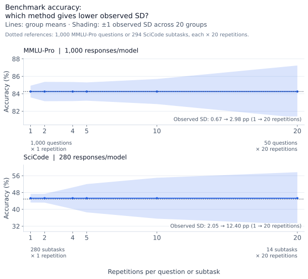
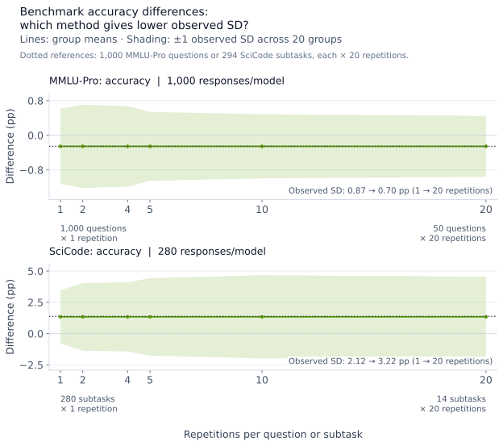
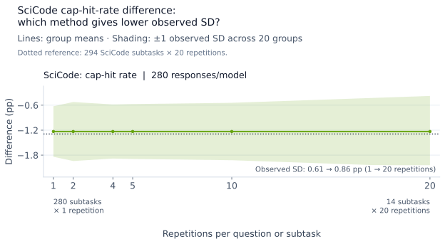
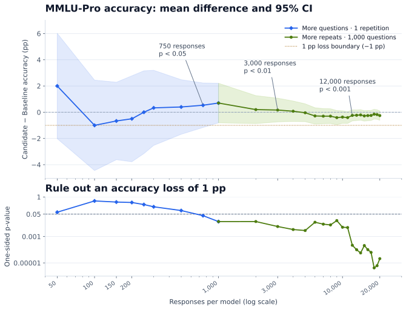

:orphan:

Evaluating Models Efficiently During Optimization Experiments
#############################################################

:Author: `Daniel Korzekwa <https://github.com/danielkorzekwa>`__,
         `Rohan Joshi <https://github.com/rohansjoshi>`__,
         `Chad Voegele <https://github.com/chadvoegele>`__,
         `Chenjie Luo <https://github.com/cjluo-nv>`__
:Date: November 18, 2026
:Tags: evaluation, docs, quantization, qad, fast-experimentation

Introduction
------------

When you optimize a reasoning model with NVIDIA Model Optimizer, how do you verify improvements
without overlooking regressions? Average accuracy can hide doomed reasoning loops (repetitive
reasoning that continues until the output-token limit is reached), missing answers, inappropriate
guessing, or excessive output length.

Because model generation is stochastic, we repeat evaluations to measure how scores vary between runs.
You may assume that reliable evaluation requires many repetitions. But could repeating by default
waste time? How many questions and repetitions do you need to measure improvements and rule out
regressions?

This article helps you evaluate models quickly and reliably during optimization experiments.
We illustrate these guidelines using real evaluation results from two NVFP4 Qwen3.6-35B-A3B
checkpoints.

For standardized evaluation and acceptance checks before releasing optimized models, follow the
`ModelOpt evaluation
skill <https://github.com/NVIDIA/Model-Optimizer/blob/main/skills/modelopt-evaluation/SKILL.md>`__
and `ModelOpt results-comparison
skill <https://github.com/NVIDIA/Model-Optimizer/blob/main/skills/modelopt-compare-results/SKILL.md>`__.
For benchmark commands, see the `LLM evaluation
examples <https://github.com/NVIDIA/Model-Optimizer/blob/main/examples/llm_eval/README.md>`__.

**What should you measure, and how?**

- **Show where the model improves or worsens:** use paired statistical tests to distinguish model
  differences from evaluation noise.
- **Check for regressions:** use confidence intervals and non-inferiority tests to rule out
  unacceptable regression, even if the baseline does not have a higher average score.
- **Assess model reliability:** measure doomed reasoning loops, missing answers, and whether the
  model abstains appropriately.
- **Measure inference efficiency:** compare output length, including reasoning tokens.

**How can you evaluate faster?**

- **Choose between question-level and repetition-level analysis:** match the approach to your goal
  and evaluation budget.
- **Collect as much evaluation data as you need:** use pilot results to choose enough questions or
  repetitions to assess regression.
- **Test known weaknesses on a focused subset:** failure-prone questions can reveal targeted
  improvements with fewer responses; check broader performance separately.

What should you measure, and how?
---------------------------------

We compare two NVFP4 Qwen3.6-35B-A3B checkpoints. Baseline underwent `post-training quantization
(PTQ) and quantization-aware distillation
(QAD) <https://github.com/NVIDIA/Model-Optimizer/blob/main/examples/megatron_bridge/tutorials/Qwen3.6-35B-A3B/README.md>`__,
preserving accuracy but increasing doomed reasoning loops. Candidate was trained directly from
Baseline using Kahneman–Tversky Optimization (KTO), which learns from desirable and undesirable
responses, aiming to reduce those loops while preserving accuracy. We use MMLU-Pro, SciCode and
AA-Omniscience to illustrate these evaluation guidelines. See the :doc:`reproducibility notes <reproducibility/index>`.

Choose a primary improvement metric before inspecting results. Prefer Candidate if it improves that
metric and meets your non-inferiority criteria for the others. Regressions highlight areas to improve.

Show where the model improves or worsens
~~~~~~~~~~~~~~~~~~~~~~~~~~~~~~~~~~~~~~~~

We first average each model’s correctness across repetitions of each question, then compute
**Candidate − Baseline** for each question. We calculate t-based 95% confidence intervals across
these paired question-level differences. Changes are reported in percentage points (pp), not
relative percentages. For simplicity, this example treats questions and SciCode subtasks as
independent.

We use paired question-level tests here to compare models across the domain represented by the
benchmark. Pairing can reduce variation caused by question difficulty. For standardized reporting on
a fixed benchmark, ModelOpt uses unpaired Welch t-tests on independent, complete-run scores to
estimate uncertainty from variation between runs of those exact questions.

Our primary question is whether Candidate is better than Baseline. A one-sided paired t-test can
detect improvement with less data than a two-sided test for any difference. Reverse-direction
p-values are reported for context.

Choose test directions before inspecting results. We use p < 0.05 for each test, without a stricter
threshold for testing multiple metrics. Testing more metrics gives noise more opportunities to
appear as an improvement.

“Yes” means evidence of higher Candidate accuracy (p < 0.05); “no evidence” means higher accuracy
was not established.

+----------------+----------+-----------+------------------+------------------+------------------+
| Benchmark      | Baseline | Candidate | Difference [95%  | Candidate        | Baseline higher, |
|                |          |           | CI], pp          | higher, p-value  | p-value          |
|                |          |           |                  |                  | (context)        |
+================+==========+===========+==================+==================+==================+
| MMLU-Pro       | 84.51%   | 84.26%    | −0.26 [−0.61,    | 0.920 — no       | 0.080            |
|                |          |           | +0.10]           | evidence         |                  |
+----------------+----------+-----------+------------------+------------------+------------------+
| SciCode        | 43.52%   | 44.90%    | +1.38 [+0.08,    | 0.019 — yes      | 0.981            |
|                |          |           | +2.67]           |                  |                  |
+----------------+----------+-----------+------------------+------------------+------------------+
| AA-Omniscience | 21.80%   | 21.92%    | +0.12 [−0.64,    | 0.381 — no       | 0.619            |
|                |          |           | +0.88]           | evidence         |                  |
+----------------+----------+-----------+------------------+------------------+------------------+

On SciCode, the candidate is more accurate than the baseline (+1.38 pp; p = 0.019).

Check for regressions
~~~~~~~~~~~~~~~~~~~~~

One-sided tests for improvement do not tell us about possible regression. 
Choose an acceptable accuracy-loss margin, then use a non-inferiority test to assess whether the loss is smaller. The checks below use
one-sided paired t-tests. “Yes” means the stated accuracy loss is ruled out (p < 0.05);
“no evidence” means it has not been ruled out.

============================ =================== =============== ======================
Rule out an accuracy loss of MMLU-Pro p-value    SciCode p-value AA-Omniscience p-value
============================ =================== =============== ======================
2.0 pp                       <0.001 — yes        <0.001 — yes    <0.001 — yes
1.0 pp                       <0.001 — yes        <0.001 — yes    0.002 — yes
0.5 pp                       0.088 — no evidence 0.002 — yes     0.056 — no evidence
0.1 pp                       0.804 — no evidence 0.013 — yes     0.288 — no evidence
============================ =================== =============== ======================

Assess model reliability
~~~~~~~~~~~~~~~~~~~~~~~~

Average accuracy alone does not show whether a model behaves reliably: also measure doomed reasoning
loops, missing answers, and whether it abstains when appropriate.

+------------------------+----------------------------------------------------------------------------+
| Measure                | Recommendation                                                             |
+========================+============================================================================+
| Doomed reasoning loops | Use cap-hit rates to screen for potential loops, then inspect the text to  |
|                        | confirm repetition. A cap hit reaches the configured response-token limit  |
|                        | (131,072 here).                                                            |
+------------------------+----------------------------------------------------------------------------+
| Missing final answers  | Report how often responses contain no final answer.                        |
+------------------------+----------------------------------------------------------------------------+
| Abstention ratio       | Count an abstention when the final response is non-empty and the judge     |
|                        | grades it ``NOT_ATTEMPTED`` using AA-Omniscience’s rubric.                 |
|                        | Report **abstentions / (all responses − correct responses)** alongside     |
|                        | accuracy. The denominator includes abstentions, incorrect and partial      |
|                        | answers, and missing answers.                                              |
|                        | `AA-Omniscience <https://artificialanalysis.ai/evaluations/omniscience>`__ |
|                        | is an example benchmark.                                                   |
+------------------------+----------------------------------------------------------------------------+

Rare failures can make t-based approximations unreliable, so we use paired-bootstrap 95% confidence
intervals and one-sided paired permutation tests for the rates below.
For more information on the statistical methods and possible alternatives, see
:ref:`Statistical methods <evaluation-statistical-methods>` in the Reproducibility Notes.

Doomed reasoning loops
^^^^^^^^^^^^^^^^^^^^^^

The candidate has fewer cap hits on both SciCode and AA-Omniscience (p < 0.001).
“Yes” means evidence of a lower Candidate cap-hit rate (p < 0.05); “no evidence” means a lower
rate was not established.

+----------------+---------------+---------------+---------------+---------------+---------------+
| Benchmark      | Baseline cap  | Candidate cap | Difference    | Candidate     | Candidate     |
|                | rate          | rate          | [95% CI], pp  | lower,        | higher,       |
|                |               |               |               | p-value       | p-value       |
|                |               |               |               |               | (context)     |
+================+===============+===============+===============+===============+===============+
| MMLU-Pro       | 0.05%         | 0.03%         | −0.02 [−0.07, | 0.244 — no    | 0.878         |
|                | (10/20,000)   | (6/20,000)    | +0.02]        | evidence      |               |
+----------------+---------------+---------------+---------------+---------------+---------------+
| SciCode        | 1.29%         | 0.00%         | −1.29 [−1.70, | <0.001 — yes  | 1.000         |
|                | (76/5,880)    | (0/5,880)     | −0.92]        |               |               |
+----------------+---------------+---------------+---------------+---------------+---------------+
| AA-Omniscience | 1.77%         | 0.85%         | −0.92 [−1.38, | <0.001 — yes  | 1.000         |
|                | (106/6,000)   | (51/6,000)    | −0.48]        |               |               |
+----------------+---------------+---------------+---------------+---------------+---------------+

Missing final answers
^^^^^^^^^^^^^^^^^^^^^

The candidate also reduced missing final answers on SciCode and AA-Omniscience (p < 0.001).
“Yes” means evidence of a lower Candidate missing-answer rate (p < 0.05); “no evidence” means a
reduction was not established.

+----------------+---------------+---------------+---------------+---------------+---------------+
| Benchmark      | Baseline      | Candidate     | Difference    | Candidate     | Candidate     |
|                |               |               | [95% CI], pp  | lower,        | higher,       |
|                |               |               |               | p-value       | p-value       |
|                |               |               |               |               | (context)     |
+================+===============+===============+===============+===============+===============+
| MMLU-Pro       | 0.05%         | 0.03%         | −0.02 [−0.07, | 0.244 — no    | 0.878         |
|                | (10/20,000)   | (6/20,000)    | +0.02]        | evidence      |               |
+----------------+---------------+---------------+---------------+---------------+---------------+
| SciCode        | 1.31%         | 0.00%         | −1.31 [−1.72, | <0.001 — yes  | 1.000         |
|                | (77/5,880)    | (0/5,880)     | −0.94]        |               |               |
+----------------+---------------+---------------+---------------+---------------+---------------+
| AA-Omniscience | 1.77%         | 0.85%         | −0.92 [−1.38, | <0.001 — yes  | 1.000         |
|                | (106/6,000)   | (51/6,000)    | −0.48]        |               |               |
+----------------+---------------+---------------+---------------+---------------+---------------+

Abstention ratio
^^^^^^^^^^^^^^^^

`AA-Omniscience public
v1 <https://huggingface.co/datasets/ArtificialAnalysis/AA-Omniscience-Public>`__ distinguishes
abstention from incorrect guessing. Its ``NOT_ATTEMPTED`` category includes some uncertain guesses.
We exclude empty final responses.

“Yes” means evidence of a higher Candidate abstention rate among non-correct responses
(p < 0.05); “no evidence” means an increase was not established.

+---------------+---------------+---------------+---------------+---------------+---------------+
| Measure       | Baseline      | Candidate     | Difference    | Candidate     | Candidate     |
|               |               |               | [95% CI], pp  | higher,       | lower,        |
|               |               |               |               | p-value       | p-value       |
|               |               |               |               |               | (context)     |
+===============+===============+===============+===============+===============+===============+
| Abstention    | 17.39%        | 19.00%        | +1.61 [+0.31, | 0.008 — yes   | 0.992         |
| ratio         | (816/4,692)   | (890/4,685)   | +2.91]        |               |               |
+---------------+---------------+---------------+---------------+---------------+---------------+

Candidate has a higher abstention ratio (p = 0.008).

Compare outcomes on the same questions to check whether Candidate abstains where Baseline answers
correctly or incorrectly.

Measure inference efficiency
~~~~~~~~~~~~~~~~~~~~~~~~~~~~

Compare mean and median completion tokens, including reasoning, to assess how much generation each
answer requires.

For mean length, we use the same question-level paired t-tests and t-based 95% confidence intervals
as accuracy. “Yes” means evidence of shorter Candidate completions on average (p < 0.05);
“no evidence” means a lower mean length was not established.

+----------------+-------------+-------------+-------------+-------------+-------------+-------------+
| Benchmark      | Baseline:   | Candidate:  | Change:     | Mean change | Candidate   | Candidate   |
|                | mean /      | mean /      | mean /      | [95% CI],   | shorter,    | longer,     |
|                | median      | median      | median, %   | tokens      | p-value     | p-value     |
|                |             |             |             |             |             | (context)   |
+================+=============+=============+=============+=============+=============+=============+
| MMLU-Pro       | 2,803 /     | 2,759 /     | −1.6% /     | −44 [−99,   | 0.057 — no  | 0.943       |
|                | 2,157       | 2,145       | −0.6%       | +11]        | evidence    |             |
+----------------+-------------+-------------+-------------+-------------+-------------+-------------+
| SciCode        | 6,188 /     | 3,048 /     | −50.7% /    | −3,140      | <0.001 —    | 1.000       |
|                | 3,205       | 1,802       | −43.8%      | [−3,666,    | yes         |             |
|                |             |             |             | −2,614]     |             |             |
+----------------+-------------+-------------+-------------+-------------+-------------+-------------+
| AA-Omniscience | 4,280 /     | 3,097 /     | −27.6% /    | −1,183      | <0.001 —    | 1.000       |
|                | 1,756       | 1,705       | −2.9%       | [−1,764,    | yes         |             |
|                |             |             |             | −602]       |             |             |
+----------------+-------------+-------------+-------------+-------------+-------------+-------------+

The candidate uses fewer tokens on average on SciCode and AA-Omniscience (p < 0.001).

How can you evaluate faster?
----------------------------

When reducing question coverage, choose a representative subset before inspecting results and use
the same question IDs for both models. See :ref:`Data preparation <evaluation-data-preparation>`
for how we selected the benchmark questions.

.. _evaluation-prioritize-question-coverage:
.. _evaluation-choose-questions-and-repetitions:

Choose between question-level and repetition-level analysis
~~~~~~~~~~~~~~~~~~~~~~~~~~~~~~~~~~~~~~~~~~~~~~~~~~~~~~~~~~~~~~~~

Both approaches are valid. Choose based on your goal and the balance between precision and
evaluation speed:

- **Repetition-level: estimate accuracy on a fixed benchmark.** Treat its question set as a black box:
  compute one average score per complete run, then estimate uncertainty across independent runs.
  Multiple complete passes can be expensive.
- **Question-level: get accurate results quickly for the domain represented by a benchmark.**
  Use representative questions: compute an average score per question across repetitions, then
  estimate uncertainty across questions. With sufficiently independent questions, this approach can support faster experimentation.

In both approaches, we produce the same aggregate mean score by averaging across all questions
and repetitions. Using question-level versus repetition-level analysis only changes how uncertainty
is estimated with confidence intervals. Keep per-question results for more detailed paired
comparisons across experiments.

Is question-level analysis reliable on real benchmarks compared with repetition-level analysis?
We compare the two approaches by spending the same response budget on more unique questions or
more repetitions per question, then measuring how much the resulting scores vary. Each allocation
produces 20 observed scores, using 1,000
responses per model for MMLU-Pro and 280 for SciCode.

At the same response budget, more questions with fewer repetitions give more consistent Candidate
accuracy estimates on both MMLU-Pro and SciCode, with lower observed standard deviation (SD).
Shading shows ±1 SD across 20 group scores; solid lines show their mean.

For Candidate − Baseline accuracy differences, more repetitions give slightly lower observed SD
on MMLU-Pro, while more question coverage gives lower SD on SciCode.

For SciCode, more subtasks with fewer repetitions give a more consistent estimate of Candidate's
cap-hit-rate reduction relative to Baseline, with lower observed SD.

.. _evaluation-collect-data:

Collect as much evaluation data as you need
~~~~~~~~~~~~~~~~~~~~~~~~~~~~~~~~~~~~~~~~~~~

You may not need the full evaluation budget to detect an improvement or rule out an unacceptable
regression. The data needed depends on the model pair, metric, acceptable regression margin, and
statistical target. We illustrate this by estimating how many responses are needed to detect fewer cap hits on
SciCode and to rule out a 1 pp accuracy loss on MMLU-Pro.

**How many responses show fewer cap hits on SciCode?**

After completing all 20 repetitions, we analyzed subsets of the saved responses: first 10–294
subtasks with one repetition, then additional repetitions on all 294 subtasks. In this retrospective
comparison, the p-value first fell below 0.05 at 588 responses per model and below 0.001 at 882.

.. image:: images/scicode-cap-data-volume.svg
   :alt: SciCode cap-hit rate evidence excluding the 44 recovery-training subtasks: blue points increase coverage from ten to 294 subtasks with one repetition; green points add repetitions on all 294 subtasks, reaching 5,880 responses per model. Subsets of ten to 150 subtasks observe no cap hits and have no informative bootstrap interval. The lower panel shows permutation p-values.
   :width: 640px

**How many responses rule out a 1 pp accuracy loss on MMLU-Pro?**

We first compare subsets of 50–1,000 questions with one repetition, keeping approximately the same
subject proportions, then add repetitions on all 1,000 questions. To rule out a 1 pp accuracy loss,
the non-inferiority test first reached p < 0.05 with one repetition on 750 questions. It first reached
p < 0.01 at 3,000 responses and p < 0.001 at 12,000 per model among the tested sizes.

The amount of data you need depends on the checkpoints you compare, the claim you want to test,
and your p-value threshold. A large improvement may be clear with few responses. Use a small
pilot to plan how many questions and repetitions to run.

anel shows one-sided non-inferiority p-values for a loss below 1 pp, with a dashed line at p = 0.05.
   :width: 640px

Test known weaknesses on a focused subset
~~~~~~~~~~~~~~~~~~~~~~~~~~~~~~~~~~~~~~~~~

Freeze a subset from earlier baseline failures to screen for targeted improvements. Our focused
subset uses 11 held-out subtasks × 10 repetitions (110 responses per model). For comparison, the
SciCode row shows the broader evaluation: 294 subtasks × 20 repetitions (5,880 responses per model).

“Yes” means evidence of a lower Candidate cap-hit rate (p < 0.05); “no evidence” means a lower
rate was not established.

+----------------+---------------+---------------+---------------+---------------+---------------+
| Benchmark      | Baseline cap  | Candidate cap | Difference    | Candidate     | Candidate     |
|                | rate          | rate          | [95% CI], pp  | lower,        | higher,       |
|                |               |               |               | p-value       | p-value       |
|                |               |               |               |               | (context)     |
+================+===============+===============+===============+===============+===============+
| SciCode        | 1.29%         | 0.00%         | −1.29 [−1.70, | <0.001 — yes  | 1.000         |
|                | (76/5,880)    | (0/5,880)     | −0.92]        |               |               |
+----------------+---------------+---------------+---------------+---------------+---------------+
| Focused subset | 10.91%        | 0.00% (0/110) | −10.91        | 0.004 — yes   | 1.000         |
|                | (12/110)      |               | [−18.18,      |               |               |
|                |               |               | −5.45]        |               |               |
+----------------+---------------+---------------+---------------+---------------+---------------+

The focused held-out subset detects fewer candidate cap hits with 110 responses per model. Use it
for a quick check of known weaknesses, then evaluate broader accuracy and reliability separately.

.. toctree::
   :hidden:
   :maxdepth: 1

   Reproducibility notes <reproducibility/index>
