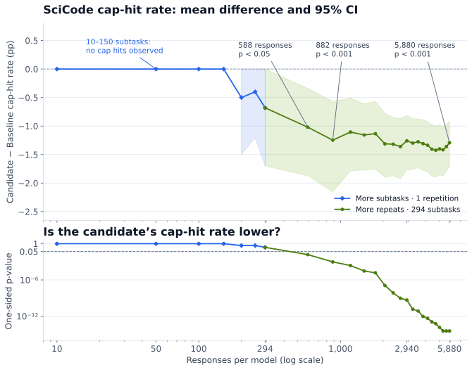

:orphan:

Evaluating Models Efficiently During Optimization Experiments
#############################################################

:Author: `Daniel Korzekwa <https://github.com/danielkorzekwa>`__,
         `Rohan Joshi <https://github.com/rohansjoshi>`__,
         `Chad Voegele <https://github.com/chadvoegele>`__,
         `Chenjie Luo <https://github.com/cjluo-nv>`__
:Date: November 18, 2026
:Tags: evaluation, docs, quantization, qad, fast-experimentation

Introduction
------------

When you optimize a reasoning model with NVIDIA Model Optimizer, how do you verify improvements
without overlooking regressions? Average accuracy can hide doomed reasoning loops (repetitive
reasoning that continues until the output-token limit is reached), missing answers, inappropriate
guessing, or excessive output length.

Because model generation is stochastic, we repeat evaluations to measure how scores vary between runs.
You may assume that reliable evaluation requires many repetitions. But could repeating by default
waste time? How many questions and repetitions do you need to measure improvements and rule out
regressions?

This article helps you evaluate models quickly and reliably during optimization experiments.
We use SciCode to compare two NVFP4 Qwen3.6-35B-A3B checkpoints and test whether
Kahneman–Tversky Optimization (KTO) reduces reasoning loops while preserving accuracy.
See how we apply these guidelines in practice across a broader set of benchmarks in the
`KTO tutorial
<https://github.com/NVIDIA/Model-Optimizer/blob/13ad0ef401ec5e4480abd1b8eb236ccdf50ef802/examples/megatron_bridge/tutorials/Qwen3.6-35B-A3B/kto/README.md>`__.

For standardized evaluation and acceptance checks before releasing optimized models, follow the
`ModelOpt evaluation
skill <https://github.com/NVIDIA/Model-Optimizer/blob/main/skills/modelopt-evaluation/SKILL.md>`__
and `ModelOpt results-comparison
skill <https://github.com/NVIDIA/Model-Optimizer/blob/main/skills/modelopt-compare-results/SKILL.md>`__.
For benchmark commands, see the `LLM evaluation
examples <https://github.com/NVIDIA/Model-Optimizer/blob/main/examples/llm_eval/README.md>`__.

**What should you measure, and how?**

- **Show where the model improves or worsens:** use paired statistical tests to distinguish model
  differences from evaluation noise.
- **Check for regressions:** use confidence intervals and non-inferiority tests to rule out
  unacceptable regression, even if the baseline does not have a higher average score.
- **Assess model reliability:** measure doomed reasoning loops, missing answers, and whether the
  model abstains appropriately.
- **Measure verbosity:** compare output length, including reasoning tokens.

**How can you evaluate faster?**

- **Choose between question-level and repetition-level analysis:** match the approach to your goal
  and evaluation budget.
- **Collect as much evaluation data as you need:** use pilot results to choose enough questions or
  repetitions to assess regression.
- **Test known weaknesses on a focused subset:** failure-prone questions can reveal targeted
  improvements with fewer responses; check broader performance separately.

What should you measure, and how?
---------------------------------

Choose a primary improvement metric before inspecting results. Prefer Candidate
if it improves that metric and meets your non-inferiority criteria for the others. Regressions
highlight areas to improve.

Show where the model improves or worsens
~~~~~~~~~~~~~~~~~~~~~~~~~~~~~~~~~~~~~~~~

Our primary question is whether Candidate is better than Baseline. We use paired question-level
tests here to compare models across the domain represented by the benchmark. Pairing can reduce
variation caused by question difficulty. For standardized reporting on a fixed benchmark, ModelOpt
uses unpaired Welch t-tests on independent, complete-run scores to estimate uncertainty from
variation between runs of those exact questions.

We use a paired 95% bootstrap confidence interval to show the uncertainty in the mean accuracy
difference and a one-sided paired permutation test to assess evidence of improvement. A one-sided
paired test can detect improvement with less data than a two-sided test for any difference.
The bootstrap and permutation test account for correlations among subtasks from the same SciCode
parent problem and assume independence across parent problems. See the
:ref:`SciCode accuracy calculation <evaluation-statistical-methods>` in the Reproducibility Notes.

The SciCode table reports the Candidate − Baseline accuracy difference in percentage points (pp)
and shows reverse-direction p-values for context. We use p < 0.05 for each test. “No evidence”
means higher Candidate accuracy was not established at that threshold.

+----------------+----------+-----------+------------------+------------------+------------------+
| Benchmark      | Baseline | Candidate | Difference [95%  | Candidate        | Baseline higher, |
|                |          |           | CI], pp          | higher, p-value  | p-value          |
|                |          |           |                  |                  | (context)        |
+================+==========+===========+==================+==================+==================+
| SciCode        | 42.81%   | 44.39%    | +1.57 [−0.48,    | 0.080 — no       | 0.931            |
|                |          |           | +3.67]           | evidence         |                  |
+----------------+----------+-----------+------------------+------------------+------------------+

Check for regressions
~~~~~~~~~~~~~~~~~~~~~

One-sided tests for improvement do not tell us about possible regression.
Choose an acceptable accuracy-loss margin for your use case before inspecting results, then
use a non-inferiority test to assess whether the loss is smaller. See the
:ref:`non-inferiority calculation <evaluation-statistical-methods>` in the Reproducibility Notes.

The table illustrates two possible margins on SciCode.
“Yes” means the stated accuracy loss is ruled out (p < 0.05).

============================ ===================
Rule out an accuracy loss of SciCode p-value
============================ ===================
1.0 pp                       0.009 — yes
0.5 pp                       0.028 — yes
============================ ===================

Assess model reliability
~~~~~~~~~~~~~~~~~~~~~~~~

Average accuracy alone does not show whether a model behaves reliably: also measure doomed reasoning
loops, missing answers, and whether it abstains when appropriate.

+------------------------+----------------------------------------------------------------------------+
| Measure                | Recommendation                                                             |
+========================+============================================================================+
| Doomed reasoning loops | Use cap-hit rates to screen for potential loops, then inspect the text to  |
|                        | confirm repetition. A cap hit reaches the configured response-token limit  |
|                        | (131,072 here).                                                            |
+------------------------+----------------------------------------------------------------------------+
| Missing final answers  | Report how often responses contain no final answer.                        |
+------------------------+----------------------------------------------------------------------------+
| Abstention ratio       | Count an abstention when the final response is non-empty and the judge     |
|                        | grades it ``NOT_ATTEMPTED`` using AA-Omniscience’s rubric.                 |
|                        | Report **abstentions / (all responses − correct responses)** alongside     |
|                        | accuracy. The denominator includes abstentions, incorrect and partial      |
|                        | answers, and missing answers.                                              |
|                        | `AA-Omniscience <https://artificialanalysis.ai/evaluations/omniscience>`__ |
|                        | is an example benchmark.                                                   |
+------------------------+----------------------------------------------------------------------------+

The doomed reasoning loops example below shows how to report rare failures using cap-hit rates.
Rare failures can make t-based approximations unreliable, so we use paired-bootstrap 95% confidence
intervals and one-sided paired permutation tests for the rates below. As in the accuracy
analysis, both methods account for correlations among subtasks from the same SciCode parent
problem.
The confidence intervals and p-values come from different procedures and need not lead to the
same conclusion. See the :ref:`cap-hit rate calculation <evaluation-statistical-methods>` in the
Reproducibility Notes.

The candidate has fewer cap hits on SciCode (p < 0.001).
“Yes” means evidence of a lower Candidate cap-hit rate (p < 0.05).

+----------------+---------------+---------------+---------------+---------------+---------------+
| Benchmark      | Baseline cap  | Candidate cap | Difference    | Candidate     | Candidate     |
|                | rate          | rate          | [95% CI], pp  | lower,        | higher,       |
|                |               |               |               | p-value       | p-value       |
|                |               |               |               |               | (context)     |
+================+===============+===============+===============+===============+===============+
| SciCode        | 1.53%         | 0.00%         | −1.53 [−2.03, | <0.001 — yes  | 1.000         |
|                | (36/2,352)    | (0/2,352)     | −1.04]        |               |               |
+----------------+---------------+---------------+---------------+---------------+---------------+

.. tip::

   For exploratory evaluations on vLLM, enable its repetition detector to stop looping
   responses early and save GPU time. Use the same settings for both checkpoints. Save the
   stop reason so you can inspect the stopped responses and compare how often the detector
   triggers for each checkpoint. To measure how often responses would reach the token cap
   without early stopping, run with the detector off. See the
   `ModelOpt instructions for stopping repeated reasoning
   <https://github.com/NVIDIA/Model-Optimizer/blob/main/skills/modelopt-evaluation/references/doom_loops.md>`__.

Measure verbosity
~~~~~~~~~~~~~~~~~

Compare mean and median completion tokens, including reasoning, to assess how much generation each
answer requires. A paired 95% confidence interval shows how precisely we estimate the difference in mean
completion length. The one-sided p-value helps assess whether Candidate produces shorter
completions on average. The table marks p < 0.05 as “yes.” See the
:ref:`verbosity calculation <evaluation-statistical-methods>` in the Reproducibility Notes.

+----------------+-------------+-------------+-------------+-------------+-------------+-------------+
| Benchmark      | Baseline:   | Candidate:  | Change:     | Mean change | Candidate   | Candidate   |
|                | mean /      | mean /      | mean /      | [95% CI],   | shorter,    | longer,     |
|                | median      | median      | median, %   | tokens      | p-value     | p-value     |
|                |             |             |             |             |             | (context)   |
+================+=============+=============+=============+=============+=============+=============+
| SciCode        | 6,512 /     | 3,063 /     | −53.0% /    | −3,450      | <0.001 —    | 1.000       |
|                | 2,993       | 1,803       | −39.8%      | [−4,236,    | yes         |             |
|                |             |             |             | −2,664]     |             |             |
+----------------+-------------+-------------+-------------+-------------+-------------+-------------+

How can you evaluate faster?
----------------------------

.. _evaluation-prioritize-question-coverage:
.. _evaluation-choose-questions-and-repetitions:

Choose between question-level and repetition-level analysis
~~~~~~~~~~~~~~~~~~~~~~~~~~~~~~~~~~~~~~~~~~~~~~~~~~~~~~~~~~~~~~~~

Both approaches are valid. Choose based on your goal and the balance between precision and
evaluation speed:

- **Repetition-level: estimate accuracy on a fixed benchmark.** Treat its question set as a black box:
  compute one average score per complete run, then estimate uncertainty across independent runs.
  Multiple complete passes can be expensive. If scores vary widely across runs, you need more
  repetitions to reach the same precision.
- **Question-level: get accurate results quickly for the domain represented by a benchmark.**
  Use representative questions: compute an average score per question across repetitions, then
  estimate uncertainty across questions. With sufficiently independent questions, this approach can support faster experimentation.

In both approaches, we produce the same aggregate mean score by averaging across all questions
and repetitions. Using question-level versus repetition-level analysis only changes how we
calculate confidence intervals and p-values. What you can compare later depends on the results
you use:

- **Within an experiment**, use paired analysis when both checkpoints answer the same questions.
- **Across experiments**, report an aggregate score per checkpoint. Keep per-question results for
  paired analysis when you can match the question IDs.

Is question-level analysis reliable on real benchmarks compared with repetition-level analysis?
We compare the two approaches by spending the same response budget on more unique questions or
more repetitions per question, then measuring how much the resulting scores vary.
On SciCode, more subtasks with fewer repetitions gave more consistent Candidate accuracy
estimates at the same response budget. At each repetition count, we split the saved responses
into eight groups of 280 responses per model. Each group covers 280 subtasks at one repetition,
down to 35 subtasks at eight repetitions. The plot shows how much accuracy varied across the
groups.
The choice of analysis level may depend on the benchmark and metric. See the
:ref:`fixed-budget analysis <evaluation-fixed-response-budgets>` in the Reproducibility Notes.

.. figure:: images/budget-allocation-scicode-accuracy.svg
   :alt: Mean Candidate accuracy on SciCode with shading showing one observed standard deviation on either side of the mean. At 280 responses per model, the estimate varies less with more subtasks and fewer repetitions.
   :width: 720px

.. _evaluation-collect-data:

Collect as much evaluation data as you need
~~~~~~~~~~~~~~~~~~~~~~~~~~~~~~~~~~~~~~~~~~~

You may not need the full evaluation budget to detect an improvement or rule out an unacceptable
regression. The data needed depends on the model pair, metric, acceptable regression margin, and
statistical target.

**How many responses show fewer cap hits on SciCode?**

After completing all eight repetitions, we analyzed subsets of the saved responses. We first
increased coverage from 10 to 294 subtasks with one repetition, then added repetitions on all
294 subtasks. In this retrospective comparison, the p-value first fell below 0.05 at 250
responses per model and below 0.001 at 882.
See the :ref:`cap-hit p-value calculation <evaluation-scicode-cap-hit-p-values>` in the Reproducibility Notes.

A large drop in cap-hit rate from Baseline to Candidate may be detectable with only a few
repetitions. Use a small pilot to estimate the size of the difference for your checkpoints
and plan how many subtasks and repetitions to run.

wer panel shows permutation p-values.
   :width: 640px

Test known weaknesses on a focused subset
~~~~~~~~~~~~~~~~~~~~~~~~~~~~~~~~~~~~~~~~~

Freeze a subset from earlier baseline failures to screen for targeted improvements. On SciCode,
we identified 55 subtasks with earlier Baseline failures, used 44 for training, and held out 11
for validation. The focused evaluation used those 11 subtasks × 8 repetitions (88 responses per
model), compared with 294 subtasks × 8 repetitions (2,352 responses per model) in the broader
evaluation. As intended, Baseline’s cap-hit rate was higher on the focused subset
(10.23%, compared with 1.53% in the broader evaluation).
Use it for a quick check of known weaknesses, then evaluate broader accuracy and reliability
separately.

“Yes” means evidence of a lower Candidate cap-hit rate (p < 0.05).

+----------------+---------------+---------------+---------------+---------------+---------------+
| Benchmark      | Baseline cap  | Candidate cap | Difference    | Candidate     | Candidate     |
|                | rate          | rate          | [95% CI], pp  | lower,        | higher,       |
|                |               |               |               | p-value       | p-value       |
|                |               |               |               |               | (context)     |
+================+===============+===============+===============+===============+===============+
| Focused subset | 10.23%        | 0.00% (0/88)  | −10.23        | 0.004 — yes   | 1.000         |
|                | (9/88)        |               | [−14.77,      |               |               |
|                |               |               | −5.68]        |               |               |
+----------------+---------------+---------------+---------------+---------------+---------------+

.. toctree::
   :hidden:
   :maxdepth: 1

   Reproducibility notes <reproducibility/index>
