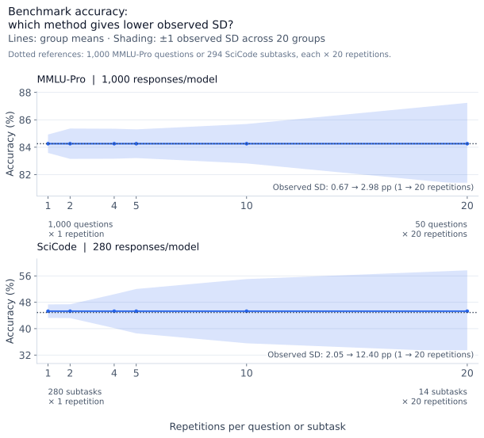
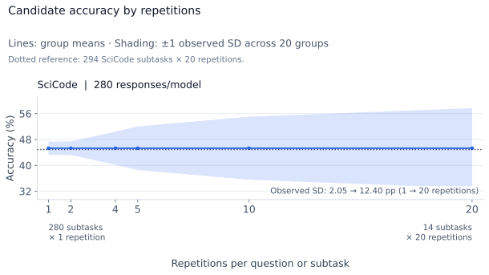
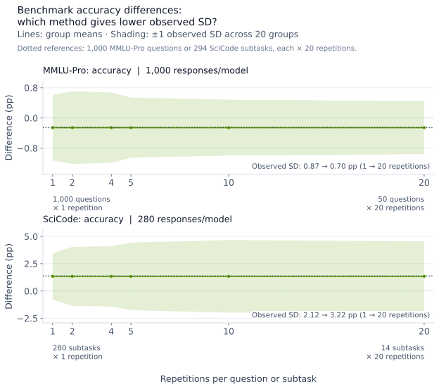
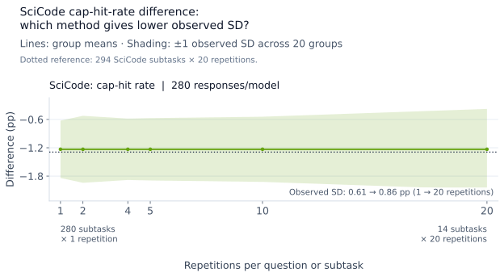
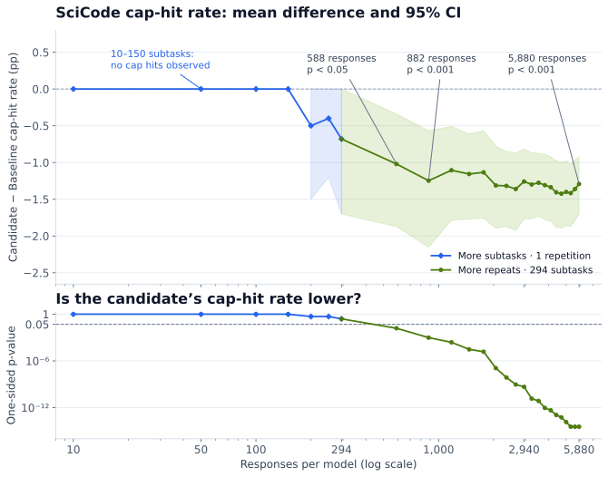
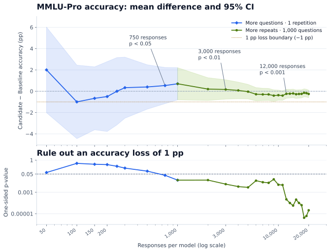

Reproducibility notes
=====================

These notes describe how the checkpoints were prepared and evaluated for the
:doc:`evaluation article <../index>`.

Baseline and Candidate checkpoints
----------------------------------

Baseline is NVFP4 Qwen3.6-35B-A3B after PTQ and QAD. The `PTQ/QAD
tutorial <https://github.com/NVIDIA/Model-Optimizer/blob/main/examples/megatron_bridge/tutorials/Qwen3.6-35B-A3B/README.md>`__
describes that recipe.

Candidate was trained directly from Baseline using KTO in NeMo RL, with an unchanged copy of
Baseline as the reference model. We identified 55 SciCode subtasks on which Baseline had shown
reasoning loops: 44 supplied training examples and 11 were reserved for evaluation. Training used
model-generated responses: 104 correct and 104 containing reasoning loops. After 13 optimizer steps
(KTO beta 0.05, learning rate 1e-6) with simulated NVFP4 quantization, Candidate was exported to
NVFP4.

.. _evaluation-data-preparation:

Data preparation
----------------

For representative evaluation, select seeded random subsets before inspecting results, stratifying
by subject where appropriate. Freeze matching question IDs across models.

- **MMLU-Pro:** we sample 1,000 of 12,032 test questions across all 14 subjects, in proportion to
  each subject's size.
- **SciCode:** the main results cover 294 of 338 subtasks, excluding the 44 used for KTO recovery
  training. KTO used model-generated responses, not reference answers.
- **Focused SciCode:** we use 11 held-out subtasks where Baseline previously showed reasoning loops
  to check whether Candidate reduces those loops.

Baseline and Candidate answered the same benchmark questions with matched generation seeds.

+------------------------------+------------------------------+-------------+---------------------+
| Benchmark                    | Questions or subtasks        | Repetitions | Responses per model |
+==============================+==============================+=============+=====================+
| MMLU-Pro                     | 1,000 questions sampled      | 20          | 20,000              |
|                              | across all 14 subjects       |             |                     |
+------------------------------+------------------------------+-------------+---------------------+
| SciCode                      | 294 subtasks                 | 20          | 5,880               |
+------------------------------+------------------------------+-------------+---------------------+
| SciCode focused subset       | 11 challenging, loop-prone   | 10          | 110                 |
|                              | held-out subtasks            |             |                     |
+------------------------------+------------------------------+-------------+---------------------+
| AA-Omniscience public v1     | 600 questions                | 10          | 6,000               |
+------------------------------+------------------------------+-------------+---------------------+

Evaluation setup
----------------

For benchmark evaluation, both models generated responses with temperature ``0.6``, top-p ``0.95``,
a ``131072``-token completion cap, and a ``262144``-token context window.

Saved metrics
-------------

We save the means, observed standard deviations, confidence intervals, and p-values shown in the
plots as CSV summaries:

- **MMLU-Pro and SciCode: Candidate accuracy at fixed response budgets** — data used in the
  :ref:`Choose between question-level and repetition-level analysis <evaluation-accuracy-differences>` ablation.
  CSV file: :download:`budget-allocation-accuracy.csv <budget-allocation-accuracy.csv>`.
- **MMLU-Pro and SciCode: accuracy differences at fixed response budgets** — data used in the
  same ablation.
  CSV file: :download:`budget-allocation-differences.csv <budget-allocation-differences.csv>`.
- **SciCode: cap-hit-rate differences at a fixed response budget** — data used in the same ablation.
  CSV file: :download:`budget-allocation-cap-hit-differences.csv <budget-allocation-cap-hit-differences.csv>`.
- **SciCode: cap-hit rates** — data used in the :ref:`data-volume ablations <evaluation-data-volume-ablations>`.
  CSV file: :download:`scicode-cap-data-volume.csv <scicode-cap-data-volume.csv>`.
- **MMLU-Pro: accuracy regression** — data used in the :ref:`data-volume ablations <evaluation-data-volume-ablations>`.
  CSV file: :download:`mmlu-accuracy-data-volume.csv <mmlu-accuracy-data-volume.csv>`.

.. _evaluation-statistical-methods:

Statistical methods
-------------------

For accuracy, cap-hit and missing-final-answer rates, abstention ratio, and verbosity, we
calculate the difference by subtracting Baseline's value from Candidate's. Accuracy, rate, and
ratio changes are in percentage points. Verbosity differences are in completion tokens,
including reasoning tokens.

- **Accuracy and verbosity (mean completion length):** average each model's repetitions within
  each question, then subtract Baseline's average from Candidate's for that question. Across these
  paired question differences, use a two-sided t-based 95% confidence interval and one-sided paired
  t-tests for the stated direction. Degrees of freedom equal the number of questions minus one.
  Median lengths describe individual responses. The verbosity tests compare mean lengths.
- **Non-inferiority:** test whether Candidate's accuracy loss is smaller than an acceptable margin.
  For differences in pp, the t statistic is ``(mean_difference + margin) / standard_error``, using
  the upper tail and the same degrees of freedom. The analysis considered margins of 2, 1, 0.5,
  and 0.1 pp. The article illustrates the 1 pp and 0.5 pp margins.
- **Cap-hit and missing-final-answer rates:** calculate two-sided 95% paired-bootstrap
  confidence intervals by sampling questions with replacement, keeping each question's repetitions
  and both models together. MMLU-Pro and SciCode use 100,000 resamples; AA uses 50,000, preserving 100
  questions per domain. The interval endpoints are the 2.5th and 97.5th percentiles.
  If neither model has an observed failure, bootstrapping gives a [0, 0] interval. This does not
  establish that failures cannot occur or that the models have equal failure rates.

  For one-sided p-values, use a :ref:`paired permutation test <evaluation-pvalue-methods>`.
  Even when failures are rare, swapping the models' results within each question shows how
  unusual the observed difference would be if the models behaved the same.
  Computing p-values with the bootstrap would be more complicated.
- **Abstention ratio:** divide total abstentions by total responses not graded
  correct, pooling all repetitions. The denominator includes incorrect and partial answers,
  abstentions, and missing answers. Use the same domain-stratified paired question
  bootstrap, with 50,000 resamples and seed ``2026111801``, recomputing both models’ ratios and their
  difference in every resample.

The question-level tests treat questions and SciCode subtasks as independent. Related subtasks from
the same parent problem may need to be analyzed together.

Each test uses p < 0.05. We do not make that threshold stricter because other metrics were also
tested. Reverse-direction p-values provide context only.

Observed variation at fixed response budgets
~~~~~~~~~~~~~~~~~~~~~~~~~~~~~~~~~~~~~~~~~~~~

For a budget of B responses per model and R repetitions, each score averages B/R questions with
R repetitions each. We split the saved question order into consecutive groups of B/R questions
and the repetition order into blocks of R. Each response appears once per allocation; both models
use matching groups. This gives 20 group scores for each allocation, without random resampling.

The pools contain 1,000 MMLU-Pro questions × 20 repetitions and the first 280 subtasks in the frozen
SciCode evaluation order × 20 repetitions. Using 280 of the 294 held-out subtasks allows exact
grouping at every tested repetition count; the main SciCode tables still use all 294. The dotted
references use all 1,000 MMLU-Pro questions or 294 SciCode subtasks, each with 20 repetitions.

We report the mean and sample SD across the 20 group scores, using a divisor of 19 for the variance.
Accuracy means are percentages; Candidate minus Baseline differences and all SDs are in percentage
points. The means stay fixed because every allocation partitions the same saved response pool.
Groups can share question or repetition IDs, so their observed spread is descriptive; these are
not 20 new independent benchmark runs or a validation of confidence-interval coverage.

.. _evaluation-pvalue-methods:

Question-level and repetition-level p-values
~~~~~~~~~~~~~~~~~~~~~~~~~~~~~~~~~~~~~~~~~~~~

For the SciCode benchmark, a response scores 1 if it hits the completion cap and 0 otherwise.
Both methods test whether Candidate has a lower cap-hit rate, using identical responses from
294 subtasks at each repetition count.

**Question-level:** average each model's cap-hit outcomes across repetitions within each subtask,
then subtract Baseline's average from Candidate's. This gives 294 paired differences. To calculate
the exact `paired permutation p-value
<https://docs.scipy.org/doc/scipy/reference/generated/scipy.stats.permutation_test.html>`__,
swap the models' results within each subtask or leave them unchanged, keeping all repetitions
together. The p-value is the fraction of possible swaps giving a mean difference equal to or lower
than the observed difference, including ties.

Cap hits are rare, so most subtask differences are zero. The permutation test avoids relying on a
t-distribution approximation for these sparse differences. It assumes that the models' results
within each subtask are interchangeable under the null hypothesis.

The outcomes are binary, but a simple binomial test on pooled responses would ignore question
pairing and repetitions within each question. With one response per model and question, an
`exact McNemar test
<https://www.statsmodels.org/stable/generated/statsmodels.stats.contingency_tables.mcnemar.html>`__
is another paired option.

We use the same paired permutation method for the guide's cap-hit and missing-final-answer
p-values, taking the tail in the stated direction.

For abstention ratio, swap the models’ complete outcomes within each question, keeping
all repetitions together. Recompute both ratios from the swapped total counts and calculate
Candidate − Baseline. Use the upper tail for the “Candidate higher” p-value and the lower tail for
the context p-value, including ties. We enumerate the joint distribution of differences in
abstention and non-correct counts to obtain these exact permutation p-values.

**Repetition-level:** for each model and repetition, divide the number of cap hits by 294. Apply a
`one-sided Welch t-test
<https://docs.scipy.org/doc/scipy/reference/generated/scipy.stats.ttest_ind.html>`__
to the models' per-repetition average scores (cap-hit rates), testing whether Candidate's mean
is lower than Baseline's.
The calculation uses each model's sample variance across repetitions and Welch's degrees of
freedom. It treats runs as independent and allows different variances for the two models.
At least two repetitions per model are needed to estimate those variances; with very few
repetitions, the estimates may be unstable.

Ablations
---------

.. _evaluation-accuracy-differences:

Choose between question-level and repetition-level analysis
~~~~~~~~~~~~~~~~~~~~~~~~~~~~~~~~~~~~~~~~~~~~~~~~~~~~~~~~~~~

We compare the two approaches by spending the same response budget on more unique questions or
more repetitions per question, then measuring how much the resulting scores vary. Each allocation
produces 20 observed scores, using 1,000 responses per model for MMLU-Pro and 280 for SciCode.

At the same response budget, more questions with fewer repetitions give more consistent Candidate
accuracy estimates on both MMLU-Pro and SciCode, with lower observed standard deviation (SD).
Shading shows ±1 SD across 20 group scores; solid lines show their mean.

For Candidate − Baseline accuracy differences, more repetitions give slightly lower observed SD
on MMLU-Pro, while more question coverage gives lower SD on SciCode.

For SciCode, more subtasks with fewer repetitions give a more consistent estimate of Candidate's
cap-hit-rate reduction relative to Baseline, with lower observed SD.

.. _evaluation-data-volume-ablations:

Collect as much evaluation data as you need
~~~~~~~~~~~~~~~~~~~~~~~~~~~~~~~~~~~~~~~~~~~

**How many responses show fewer cap hits on SciCode?**

After completing all 20 repetitions, we analyzed subsets of the saved responses: first 10–294
subtasks with one repetition, then additional repetitions on all 294 subtasks. In this retrospective
comparison, the p-value first fell below 0.05 at 588 responses per model and below 0.001 at 882.

A large drop in cap-hit rate from Baseline to Candidate may be detectable with only a few
repetitions. Use a small pilot to estimate the size of the difference for your checkpoints
and plan how many subtasks and repetitions to run.

. The lower panel shows permutation p-values.
   :width: 640px

**How many responses rule out a 1 pp accuracy loss on MMLU-Pro?**

We first compare subsets of 50–1,000 questions with one repetition, keeping approximately the same
subject proportions, then add repetitions on all 1,000 questions. To rule out a 1 pp accuracy loss,
the non-inferiority test first reached p < 0.05 with one repetition on 750 questions. It first reached
p < 0.01 at 3,000 responses and p < 0.001 at 12,000 per model among the tested sizes.

The amount of data you need depends on the checkpoints you compare, the claim you want to test,
and your p-value threshold. A large improvement may be clear with few responses. Use a small
pilot to plan how many questions and repetitions to run.

anel shows one-sided non-inferiority p-values for a loss below 1 pp, with a dashed line at p = 0.05.
   :width: 640px

Reproducibility limits
----------------------

The checkpoints and paired measurements are stored outside the public ModelOpt repository.
To keep the repository lightweight, we include summary results here rather than question-level
data, generated responses, or a full experiment environment.
