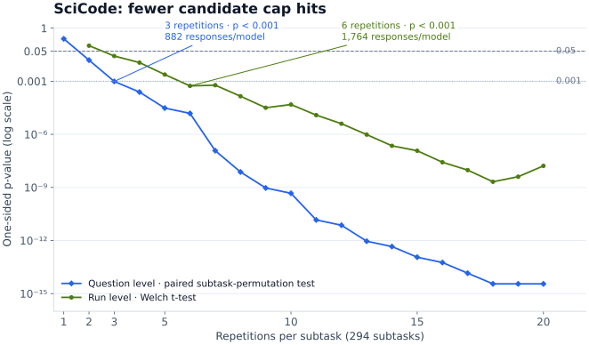
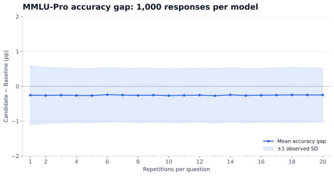
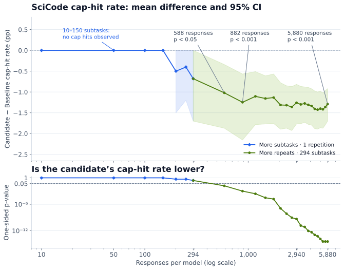
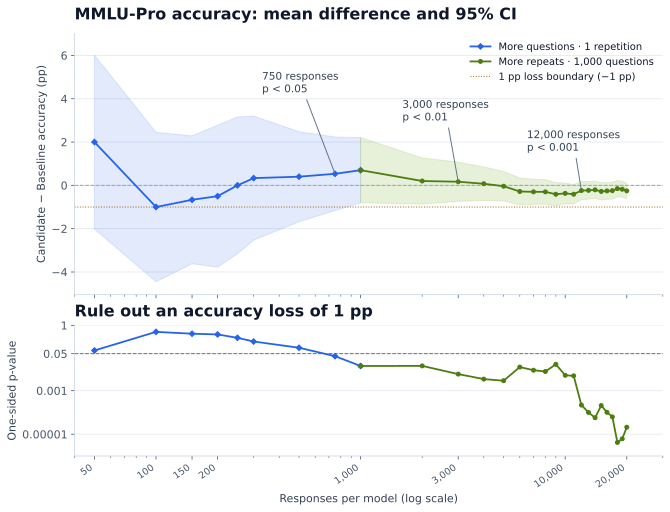

Guidelines for Evaluating Models Optimized with NVIDIA Model Optimizer
======================================================================

.. contents:: Contents
   :local:
   :depth: 2

Introduction
------------

When you optimize a reasoning model with NVIDIA Model Optimizer, how do you verify improvements
without overlooking regressions? Average accuracy can hide doomed reasoning loops (repetitive
reasoning that continues until the output-token limit is reached), missing answers, inappropriate
guessing, or excessive output length.

You may assume that reliable evaluation requires many repetitions. But could repeating by default
waste time? How many questions and repetitions do you need to measure improvements and rule out
regressions?

This guide helps you evaluate models quickly and reliably during optimization experiments.

For standardized evaluation and acceptance checks before releasing optimized models, follow the
`ModelOpt evaluation
skill <https://github.com/NVIDIA/Model-Optimizer/blob/main/plugins/modelopt/skills/evaluation/SKILL.md>`__
and `ModelOpt results-comparison
skill <https://github.com/NVIDIA/Model-Optimizer/blob/main/plugins/modelopt/skills/compare-results/SKILL.md>`__.
For benchmark commands, see the `LLM evaluation
examples <https://github.com/NVIDIA/Model-Optimizer/blob/main/examples/llm_eval/README.md>`__.

**What should you measure, and how?**

- **Show where the model improves or worsens:** use paired statistical tests to distinguish model
  differences from evaluation noise.
- **Check for regressions:** use confidence intervals and non-inferiority tests to rule out
  unacceptable regression, even if the baseline is not shown to be better.
- **Assess model reliability:** measure doomed reasoning loops, missing answers, and whether the
  model abstains appropriately.
- **Measure inference efficiency:** compare output length, including reasoning tokens.

**How can you evaluate faster?**

- **Prioritize question coverage over repetitions:** repeat evaluations when the available questions
  do not provide enough evidence.
- **Collect as much evaluation data as you need:** use pilot results to choose enough questions or
  repetitions to assess regression.
- **Test known weaknesses on a focused subset:** failure-prone questions can reveal targeted
  improvements with fewer responses; check broader performance separately.

What should you measure, and how?
---------------------------------

We compare two NVFP4 Qwen3.6-35B-A3B checkpoints. Baseline underwent `post-training quantization
(PTQ) and quantization-aware distillation
(QAD) <https://github.com/NVIDIA/Model-Optimizer/blob/main/examples/megatron_bridge/tutorials/Qwen3.6-35B-A3B/README.md>`__,
preserving accuracy but increasing doomed reasoning loops. Candidate was trained directly from
Baseline using Kahneman–Tversky Optimization (KTO), which learns from desirable and undesirable
responses, aiming to reduce those loops while preserving accuracy. We use MMLU-Pro, SciCode and
AA-Omniscience to illustrate these evaluation guidelines. See the :doc:`reproducibility notes <reproducibility/index>`.

Prefer Candidate if it improves at least one metric and meets your non-inferiority criteria for the
others. Regressions highlight areas to improve.

Show where the model improves or worsens
~~~~~~~~~~~~~~~~~~~~~~~~~~~~~~~~~~~~~~~~

We first average each model’s correctness across repetitions of each question, then compute
**Candidate − Baseline** for each question. We calculate t-based 95% confidence intervals across
these paired question-level differences. Changes are reported in percentage points (pp), not
relative percentages. For simplicity, this example treats questions and SciCode subtasks as
independent.

Our primary question is whether Candidate is better than Baseline. A one-sided paired t-test can
detect improvement with less data than a two-sided test for any difference. “Yes” marks p < 0.05;
“no evidence” means improvement was not established. Reverse-direction p-values are reported for
context.

Choose test directions before inspecting results. We use p < 0.05 for each test, without a stricter
threshold for testing multiple metrics. Testing more metrics gives noise more opportunities to
appear as an improvement.

+----------------+----------+-----------+------------------+------------------+------------------+
| Benchmark      | Baseline | Candidate | Difference [95%  | Candidate        | Baseline higher, |
|                |          |           | CI], pp          | higher, p-value  | p-value          |
|                |          |           |                  |                  | (context)        |
+================+==========+===========+==================+==================+==================+
| MMLU-Pro       | 84.51%   | 84.26%    | −0.26 [−0.61,    | 0.920 — no       | 0.080            |
|                |          |           | +0.10]           | evidence         |                  |
+----------------+----------+-----------+------------------+------------------+------------------+
| SciCode        | 43.52%   | 44.90%    | +1.38 [+0.08,    | 0.019 — yes      | 0.981            |
|                |          |           | +2.67]           |                  |                  |
+----------------+----------+-----------+------------------+------------------+------------------+
| AA-Omniscience | 21.80%   | 21.92%    | +0.12 [−0.64,    | 0.381 — no       | 0.619            |
|                |          |           | +0.88]           | evidence         |                  |
+----------------+----------+-----------+------------------+------------------+------------------+

On SciCode, the candidate is more accurate than the baseline (+1.38 pp; p = 0.019).

Check for regressions
~~~~~~~~~~~~~~~~~~~~~

No evidence of a difference does not establish no regression. Choose an acceptable accuracy-loss
margin, then use a non-inferiority test to assess whether the loss is smaller. The checks below use
one-sided paired t-tests.

============================ =================== =============== ======================
Rule out an accuracy loss of MMLU-Pro p-value    SciCode p-value AA-Omniscience p-value
============================ =================== =============== ======================
2.0 pp                       <0.001 — yes        <0.001 — yes    <0.001 — yes
1.0 pp                       <0.001 — yes        <0.001 — yes    0.002 — yes
0.5 pp                       0.088 — no evidence 0.002 — yes     0.056 — no evidence
0.1 pp                       0.804 — no evidence 0.013 — yes     0.288 — no evidence
============================ =================== =============== ======================

Assess model reliability
~~~~~~~~~~~~~~~~~~~~~~~~

Average accuracy alone does not show whether a model behaves reliably: also measure doomed reasoning
loops, missing answers, and whether it abstains when appropriate.

+------------------------+----------------------------------------------------------------------------+
| Measure                | Recommendation                                                             |
+========================+============================================================================+
| Doomed reasoning loops | Use cap-hit rates to screen for potential loops, then inspect the text to  |
|                        | confirm repetition. A cap hit reaches the configured response-token limit  |
|                        | (131,072 here).                                                            |
+------------------------+----------------------------------------------------------------------------+
| Missing final answers  | Report how often responses contain no final answer.                        |
+------------------------+----------------------------------------------------------------------------+
| Abstention             | Report intentional abstentions separately from incorrect or missing        |
|                        | answers;                                                                   |
|                        | `AA-Omniscience <https://artificialanalysis.ai/evaluations/omniscience>`__ |
|                        | is an example benchmark.                                                   |
+------------------------+----------------------------------------------------------------------------+

Rare failures can make t-based approximations unreliable, so we use paired-bootstrap 95% confidence
intervals and one-sided paired permutation tests for the rates below.

Doomed reasoning loops
^^^^^^^^^^^^^^^^^^^^^^

The candidate has fewer cap hits on both SciCode and AA-Omniscience (p < 0.001).

+----------------+---------------+---------------+---------------+---------------+---------------+
| Benchmark      | Baseline cap  | Candidate cap | Difference    | Candidate     | Candidate     |
|                | rate          | rate          | [95% CI], pp  | lower,        | higher,       |
|                |               |               |               | p-value       | p-value       |
|                |               |               |               |               | (context)     |
+================+===============+===============+===============+===============+===============+
| MMLU-Pro       | 0.05%         | 0.03%         | −0.02 [−0.07, | 0.244 — no    | 0.878         |
|                | (10/20,000)   | (6/20,000)    | +0.02]        | evidence      |               |
+----------------+---------------+---------------+---------------+---------------+---------------+
| SciCode        | 1.29%         | 0.00%         | −1.29 [−1.70, | <0.001 — yes  | 1.000         |
|                | (76/5,880)    | (0/5,880)     | −0.92]        |               |               |
+----------------+---------------+---------------+---------------+---------------+---------------+
| AA-Omniscience | 1.77%         | 0.85%         | −0.92 [−1.38, | <0.001 — yes  | 1.000         |
|                | (106/6,000)   | (51/6,000)    | −0.48]        |               |               |
+----------------+---------------+---------------+---------------+---------------+---------------+

Missing final answers
^^^^^^^^^^^^^^^^^^^^^

The candidate also reduced missing final answers on SciCode and AA-Omniscience (p < 0.001).

+----------------+---------------+---------------+---------------+---------------+---------------+
| Benchmark      | Baseline      | Candidate     | Difference    | Candidate     | Candidate     |
|                |               |               | [95% CI], pp  | lower,        | higher,       |
|                |               |               |               | p-value       | p-value       |
|                |               |               |               |               | (context)     |
+================+===============+===============+===============+===============+===============+
| MMLU-Pro       | 0.05%         | 0.03%         | −0.02 [−0.07, | 0.244 — no    | 0.878         |
|                | (10/20,000)   | (6/20,000)    | +0.02]        | evidence      |               |
+----------------+---------------+---------------+---------------+---------------+---------------+
| SciCode        | 1.31%         | 0.00%         | −1.31 [−1.72, | <0.001 — yes  | 1.000         |
|                | (77/5,880)    | (0/5,880)     | −0.94]        |               |               |
+----------------+---------------+---------------+---------------+---------------+---------------+
| AA-Omniscience | 1.77%         | 0.85%         | −0.92 [−1.38, | <0.001 — yes  | 1.000         |
|                | (106/6,000)   | (51/6,000)    | −0.48]        |               |               |
+----------------+---------------+---------------+---------------+---------------+---------------+

Abstention
^^^^^^^^^^

`AA-Omniscience public
v1 <https://huggingface.co/datasets/ArtificialAnalysis/AA-Omniscience-Public>`__ distinguishes
abstention from incorrect guessing. The Codex assistant graded responses against reference answers,
blinded to checkpoint identity. The reported configuration was GPT-6.1 Sol (xhigh); a pinned judge
snapshot was not independently verified. Deliberate abstentions exclude empty answers and uncertain
guesses.

+---------------+---------------+---------------+---------------+---------------+---------------+
| Measure       | Baseline      | Candidate     | Difference    | Candidate     | Candidate     |
|               |               |               | [95% CI], pp  | higher,       | lower,        |
|               |               |               |               | p-value       | p-value       |
|               |               |               |               |               | (context)     |
+===============+===============+===============+===============+===============+===============+
| Deliberate    | 13.30%        | 14.55%        | +1.25 [+0.23, | 0.009 — yes   | 0.993         |
| abstention    | (798/6,000)   | (873/6,000)   | +2.27]        |               |               |
+---------------+---------------+---------------+---------------+---------------+---------------+

+---------------+---------------+---------------+---------------+---------------+---------------+
| Measure       | Baseline      | Candidate     | Difference    | Candidate     | Candidate     |
|               |               |               | [95% CI], pp  | lower,        | higher,       |
|               |               |               |               | p-value       | p-value       |
|               |               |               |               |               | (context)     |
+===============+===============+===============+===============+===============+===============+
| Incorrect     | 62.03%        | 61.72%        | −0.32 [−1.57, | 0.322 — no    | 0.696         |
| answers       | (3,722/6,000) | (3,703/6,000) | +0.97]        | evidence      |               |
+---------------+---------------+---------------+---------------+---------------+---------------+

The candidate abstained more often (p = 0.009), with no evidence of fewer incorrect answers (p =
0.322).

Measure inference efficiency
~~~~~~~~~~~~~~~~~~~~~~~~~~~~

Compare mean and median completion tokens, including reasoning, to assess how much generation each
answer requires.

For mean length, we use the same question-level paired t-tests and t-based 95% confidence intervals
as accuracy.

+----------------+-------------+-------------+-------------+-------------+-------------+-------------+
| Benchmark      | Baseline:   | Candidate:  | Change:     | Mean change | Candidate   | Candidate   |
|                | mean /      | mean /      | mean /      | [95% CI],   | shorter,    | longer,     |
|                | median      | median      | median, %   | tokens      | p-value     | p-value     |
|                |             |             |             |             |             | (context)   |
+================+=============+=============+=============+=============+=============+=============+
| MMLU-Pro       | 2,803 /     | 2,759 /     | −1.6% /     | −44 [−99,   | 0.057 — no  | 0.943       |
|                | 2,157       | 2,145       | −0.6%       | +11]        | evidence    |             |
+----------------+-------------+-------------+-------------+-------------+-------------+-------------+
| SciCode        | 6,188 /     | 3,048 /     | −50.7% /    | −3,140      | <0.001 —    | 1.000       |
|                | 3,205       | 1,802       | −43.8%      | [−3,666,    | yes         |             |
|                |             |             |             | −2,614]     |             |             |
+----------------+-------------+-------------+-------------+-------------+-------------+-------------+
| AA-Omniscience | 4,280 /     | 3,097 /     | −27.6% /    | −1,183      | <0.001 —    | 1.000       |
|                | 1,756       | 1,705       | −2.9%       | [−1,764,    | yes         |             |
|                |             |             |             | −602]       |             |             |
+----------------+-------------+-------------+-------------+-------------+-------------+-------------+

The candidate uses fewer tokens on average on SciCode and AA-Omniscience (p < 0.001).

How can you evaluate faster?
----------------------------

When reducing question coverage, choose a representative subset before inspecting results and use
the same question IDs for both models. See :ref:`Data preparation <evaluation-data-preparation>`
for how we selected the benchmark questions.

.. _evaluation-prioritize-question-coverage:

Prioritize question coverage over repetitions
~~~~~~~~~~~~~~~~~~~~~~~~~~~~~~~~~~~~~~~~~~~~~

Question-level analysis asks whether Candidate performs better on average on questions like those in
the benchmark. It averages repetitions within each question and compares paired differences; with
enough independent questions, it can use one repetition. Repetition-level (run-level) analysis asks
whether Candidate performs better on average across repeated runs of the same fixed questions.
It compares aggregate benchmark scores across repetitions, so it needs multiple runs to estimate
uncertainty.

In this SciCode example, question-level analysis detects a lower Candidate cap-hit rate at p < 0.001
after three repetitions; repetition-level analysis needs six, requiring twice as many responses.
Both use identical responses from the same 294 subtasks at each repetition count. We calculate both
p-values using the methods in :ref:`Question-level and repetition-level p-values <evaluation-pvalue-methods>`
in the reproducibility notes.

es it at six repetitions, or 1,764 responses per model. Welch is unavailable with one repetition.
   :width: 640px

For MMLU-Pro, we tested whether the same response budget was better spent on more questions or more
repetitions. We used 1,000 responses per model, sampling within subjects. To calculate the overall
accuracy difference, we averaged subject results in proportion to their size in the original
1,000-question sample. Both allocations gave similarly stable estimates of the accuracy difference.
Together with the SciCode comparison, this supports prioritizing question coverage, then adding
repetitions when the available questions do not provide enough evidence.

.. _evaluation-collect-data:

Collect as much evaluation data as you need
~~~~~~~~~~~~~~~~~~~~~~~~~~~~~~~~~~~~~~~~~~~

You may not need the full evaluation budget to detect an improvement or rule out an unacceptable
regression. The data needed depends on the model pair, metric, acceptable regression margin, and
statistical target.

The plots below are retrospective examples. Their threshold crossings are not validated adaptive
stopping rules or general sample-size prescriptions.

**How many responses show fewer cap hits on SciCode?**

We first compare random subsets of 10–294 subtasks with one repetition, then add repetitions on all
294 subtasks. Among the tested sizes, the p-value first fell below 0.05 at 588 responses, and below
0.001 at 882 per model. The full 5,880 responses were unnecessary to establish evidence of fewer
candidate cap hits at those thresholds.

. The lower panel shows permutation p-values.
   :width: 640px

**How many responses rule out a 1 pp accuracy loss on MMLU-Pro?**

We first compare subsets of 50–1,000 questions with one repetition, keeping approximately the same
subject proportions, then add repetitions on all 1,000 questions. To rule out a 1 pp accuracy loss,
the non-inferiority test first reached p < 0.05 with one repetition on 750 questions. It first reached
p < 0.01 at 3,000 responses and p < 0.001 at 12,000 per model among the tested sizes.

anel shows one-sided non-inferiority p-values for a loss below 1 pp, with a dashed line at p = 0.05.
   :width: 640px

Test known weaknesses on a focused subset
~~~~~~~~~~~~~~~~~~~~~~~~~~~~~~~~~~~~~~~~~

Freeze a subset from earlier baseline failures to screen for targeted improvements. We report the 11
held-out subtasks, with ten matched repetitions—110 responses per model.

+----------------+---------------+---------------+---------------+---------------+---------------+
| Benchmark      | Baseline cap  | Candidate cap | Difference    | Candidate     | Candidate     |
|                | rate          | rate          | [95% CI], pp  | lower,        | higher,       |
|                |               |               |               | p-value       | p-value       |
|                |               |               |               |               | (context)     |
+================+===============+===============+===============+===============+===============+
| SciCode        | 1.29%         | 0.00%         | −1.29 [−1.70, | <0.001 — yes  | 1.000         |
|                | (76/5,880)    | (0/5,880)     | −0.92]        |               |               |
+----------------+---------------+---------------+---------------+---------------+---------------+
| Focused subset | 10.91%        | 0.00% (0/110) | −10.91        | 0.004 — yes   | 1.000         |
|                | (12/110)      |               | [−18.18,      |               |               |
|                |               |               | −5.45]        |               |               |
+----------------+---------------+---------------+---------------+---------------+---------------+

The focused held-out subset detects fewer candidate cap hits with 110 responses per model. Use it
for a quick check of known weaknesses, then evaluate broader accuracy and reliability separately.
