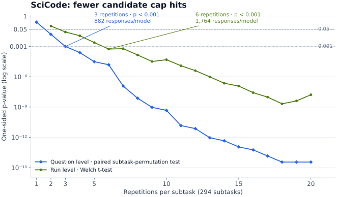
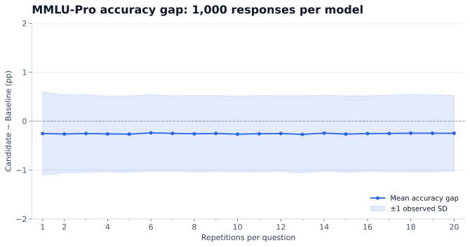
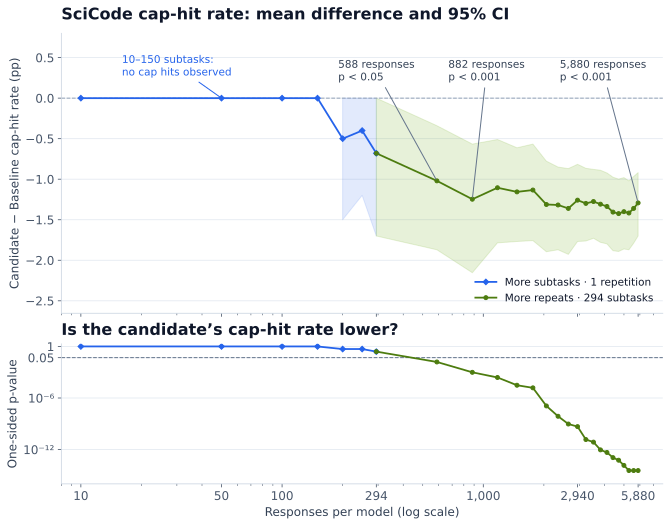
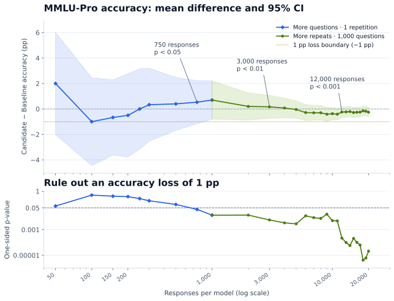

# Guidelines for Evaluating Models Optimized with NVIDIA Model Optimizer

## Contents

- [Introduction](#introduction)
- [What should you measure, and how?](#what-should-you-measure-and-how)
  - [Show where the model improves or worsens](#show-where-the-model-improves-or-worsens)
  - [Check for regressions](#check-for-regressions)
  - [Assess model reliability](#assess-model-reliability)
  - [Measure inference efficiency](#measure-inference-efficiency)
- [How can you evaluate faster?](#how-can-you-evaluate-faster)
  - [Prioritize question coverage over repetitions](#prioritize-question-coverage-over-repetitions)
  - [Collect as much evaluation data as you need](#collect-as-much-evaluation-data-as-you-need)
  - [Test known weaknesses on a focused subset](#test-known-weaknesses-on-a-focused-subset)

## Introduction

When you optimize a reasoning model with NVIDIA Model Optimizer, how do you verify improvements without overlooking regressions? Average accuracy can hide doomed reasoning loops (repetitive reasoning that continues until the output-token limit is reached), missing answers, inappropriate guessing, or excessive output length.

You may assume that reliable evaluation requires many repetitions. But could repeating by default waste time? How many questions and repetitions do you need to measure improvements and rule out regressions?

This guide helps you evaluate models quickly and reliably during optimization experiments.

For standardized evaluation and acceptance checks before releasing optimized models, follow the [ModelOpt evaluation skill](../../../plugins/modelopt/skills/evaluation/SKILL.md) and [ModelOpt results-comparison skill](../../../plugins/modelopt/skills/compare-results/SKILL.md). For benchmark commands, see the [LLM evaluation examples](../README.md).

**What should you measure, and how?**

- **Show where the model improves or worsens:** use paired statistical tests to distinguish model differences from evaluation noise.
- **Check for regressions:** use confidence intervals and non-inferiority tests to rule out unacceptable regression, even if the baseline is not shown to be better.
- **Assess model reliability:** measure doomed reasoning loops, missing answers, and whether the model abstains appropriately.
- **Measure inference efficiency:** compare output length, including reasoning tokens.

**How can you evaluate faster?**

- **Prioritize question coverage over repetitions:** repeat evaluations when the available questions do not provide enough evidence.
- **Collect as much evaluation data as you need:** use pilot results to choose enough questions or repetitions to assess regression.
- **Test known weaknesses on a focused subset:** failure-prone questions can reveal targeted improvements with fewer responses; check broader performance separately.

## What should you measure, and how?

We compare two NVFP4 Qwen3.6-35B-A3B checkpoints. Baseline underwent [post-training quantization (PTQ) and quantization-aware distillation (QAD)](https://github.com/NVIDIA/Model-Optimizer/blob/main/examples/megatron_bridge/tutorials/Qwen3.6-35B-A3B/README.md), preserving accuracy but increasing doomed reasoning loops. Candidate was trained directly from Baseline using Kahneman–Tversky Optimization (KTO), which learns from desirable and undesirable responses, aiming to reduce those loops while preserving accuracy. We use MMLU-Pro, SciCode and AA-Omniscience to illustrate these evaluation guidelines. See the [reproducibility notes](reproducibility/README.md).

### Show where the model improves or worsens

We first average each model’s correctness across repetitions of each question, then compute **Candidate − Baseline** for each question. We calculate t-based 95% confidence intervals across these paired question-level differences. Changes are reported in percentage points (pp), not relative percentages. For simplicity, this example treats questions and SciCode subtasks as independent.

Our primary question is whether Candidate is better than Baseline. A one-sided paired t-test can detect improvement with less data than a two-sided test for any difference. “Yes” marks p < 0.05; “no evidence” means improvement was not established. Reverse-direction p-values are reported for context.

Choose test directions before inspecting results. We use p < 0.05 for each test, without a stricter threshold for testing multiple metrics. Testing more metrics gives noise more opportunities to appear as an improvement.

| Benchmark | Baseline | Candidate | Difference [95% CI], pp | Candidate higher, p-value | Baseline higher, p-value (context) |
| --- | ---: | ---: | ---: | ---: | ---: |
| MMLU-Pro | 84.51% | 84.26% | −0.26 [−0.61, +0.10] | 0.920 — no evidence | 0.080 |
| SciCode | 43.52% | 44.90% | +1.38 [+0.08, +2.67] | 0.019 — yes | 0.981 |
| AA-Omniscience | 21.80% | 21.92% | +0.12 [−0.64, +0.88] | 0.381 — no evidence | 0.619 |

On SciCode, the candidate is more accurate than the baseline (+1.38 pp; p = 0.019).

### Check for regressions

No evidence of a difference does not establish no regression. Choose an acceptable accuracy-loss margin, then use a non-inferiority test to assess whether the loss is smaller. The checks below use one-sided paired t-tests.

| Rule out an accuracy loss of | MMLU-Pro p-value | SciCode p-value | AA-Omniscience p-value |
| --- | ---: | ---: | ---: |
| 2.0 pp | <0.001 — yes | <0.001 — yes | <0.001 — yes |
| 1.0 pp | <0.001 — yes | <0.001 — yes | 0.002 — yes |
| 0.5 pp | 0.088 — no evidence | 0.002 — yes | 0.056 — no evidence |
| 0.1 pp | 0.804 — no evidence | 0.013 — yes | 0.288 — no evidence |

### Assess model reliability

Average accuracy alone does not show whether a model behaves reliably: also measure doomed reasoning loops, missing answers, and whether it abstains when appropriate.

| Measure | Recommendation |
| --- | --- |
| Doomed reasoning loops | Use cap-hit rates to screen for potential loops, then inspect the text to confirm repetition. A cap hit reaches the configured response-token limit (131,072 here). |
| Missing final answers | Report how often responses contain no final answer. |
| Abstention | Report intentional abstentions separately from incorrect or missing answers; [AA-Omniscience](https://artificialanalysis.ai/evaluations/omniscience) is an example benchmark. |

Rare failures can make t-based approximations unreliable, so we use paired-bootstrap 95% confidence intervals and one-sided paired permutation tests for the rates below.

#### Doomed reasoning loops

The candidate has fewer cap hits on both SciCode and AA-Omniscience (p < 0.001).

| Benchmark | Baseline cap rate | Candidate cap rate | Difference [95% CI], pp | Candidate lower, p-value | Candidate higher, p-value (context) |
| --- | ---: | ---: | ---: | ---: | ---: |
| MMLU-Pro | 0.05% (10/20,000) | 0.03% (6/20,000) | −0.02 [−0.07, +0.02] | 0.244 — no evidence | 0.878 |
| SciCode | 1.29% (76/5,880) | 0.00% (0/5,880) | −1.29 [−1.70, −0.92] | <0.001 — yes | 1.000 |
| AA-Omniscience | 1.77% (106/6,000) | 0.85% (51/6,000) | −0.92 [−1.38, −0.48] | <0.001 — yes | 1.000 |

#### Missing final answers

The candidate also reduced missing final answers on SciCode and AA-Omniscience (p < 0.001).

| Benchmark | Baseline | Candidate | Difference [95% CI], pp | Candidate lower, p-value | Candidate higher, p-value (context) |
| --- | ---: | ---: | ---: | ---: | ---: |
| MMLU-Pro | 0.05% (10/20,000) | 0.03% (6/20,000) | −0.02 [−0.07, +0.02] | 0.244 — no evidence | 0.878 |
| SciCode | 1.31% (77/5,880) | 0.00% (0/5,880) | −1.31 [−1.72, −0.94] | <0.001 — yes | 1.000 |
| AA-Omniscience | 1.77% (106/6,000) | 0.85% (51/6,000) | −0.92 [−1.38, −0.48] | <0.001 — yes | 1.000 |

#### Abstention

[AA-Omniscience public v1](https://huggingface.co/datasets/ArtificialAnalysis/AA-Omniscience-Public) distinguishes abstention from incorrect guessing. The Codex assistant graded responses against reference answers, blinded to checkpoint identity. The reported configuration was GPT-6.1 Sol (xhigh); a pinned judge snapshot was not independently verified. Deliberate abstentions exclude empty answers and uncertain guesses.

| Measure | Baseline | Candidate | Difference [95% CI], pp | Candidate higher, p-value | Candidate lower, p-value (context) |
| --- | ---: | ---: | ---: | ---: | ---: |
| Deliberate abstention | 13.30% (798/6,000) | 14.55% (873/6,000) | +1.25 [+0.23, +2.27] | 0.009 — yes | 0.993 |

| Measure | Baseline | Candidate | Difference [95% CI], pp | Candidate lower, p-value | Candidate higher, p-value (context) |
| --- | ---: | ---: | ---: | ---: | ---: |
| Incorrect answers | 62.03% (3,722/6,000) | 61.72% (3,703/6,000) | −0.32 [−1.57, +0.97] | 0.322 — no evidence | 0.696 |

The candidate abstained more often (p = 0.009), with no evidence of fewer incorrect answers (p = 0.322).

### Measure inference efficiency

Compare mean and median completion tokens, including reasoning, to assess how much generation each answer requires.

For mean length, we use the same question-level paired t-tests and t-based 95% confidence intervals as accuracy.

| Benchmark | Baseline: mean / median | Candidate: mean / median | Change: mean / median, % | Mean change [95% CI], tokens | Candidate shorter, p-value | Candidate longer, p-value (context) |
| --- | ---: | ---: | ---: | ---: | ---: | ---: |
| MMLU-Pro | 2,803 / 2,157 | 2,759 / 2,145 | −1.6% / −0.6% | −44 [−99, +11] | 0.057 — no evidence | 0.943 |
| SciCode | 6,188 / 3,205 | 3,048 / 1,802 | −50.7% / −43.8% | −3,140 [−3,666, −2,614] | <0.001 — yes | 1.000 |
| AA-Omniscience | 4,280 / 1,756 | 3,097 / 1,705 | −27.6% / −2.9% | −1,183 [−1,764, −602] | <0.001 — yes | 1.000 |

The candidate uses fewer tokens on average on SciCode and AA-Omniscience (p < 0.001).

## How can you evaluate faster?

### Prioritize question coverage over repetitions

Question-level analysis asks whether Candidate performs better on average on questions like those in the benchmark. It averages repetitions within each question and compares paired differences. Repetition-level (run-level) analysis asks whether Candidate performs better on average across repeated runs of the same fixed questions. It compares aggregate benchmark scores across repetitions.

For SciCode, we test whether Candidate has a lower cap-hit rate than Baseline on the same 294 subtasks. The plot below compares a paired subtask-permutation test with a one-sided Welch t-test on per-repetition cap-hit rates. Using identical responses, question-level analysis reaches p < 0.001 with three repetitions; repetition-level analysis needs six, requiring twice as many responses. This SciCode cap-hit comparison illustrates fast experimentation with fewer repetitions. For a standardized evaluation and acceptance procedure, follow the [ModelOpt evaluation skill](../../../plugins/modelopt/skills/evaluation/SKILL.md) and [ModelOpt results-comparison skill](../../../plugins/modelopt/skills/compare-results/SKILL.md). Its smaller budgets do not replace the skills’ validation or [minimum-run requirements](../../../plugins/modelopt/skills/evaluation/recipes/tasks/aa/scicode.md#at-least-8-runs-mandatory).

For MMLU-Pro, we compared more questions evaluated once with fewer questions evaluated repeatedly, using 1,000 responses per model. Both approaches gave similarly stable estimates of the accuracy difference between models.

With enough independent questions, one repetition may provide sufficient evidence; see the [MMLU-Pro example in the next section](#collect-as-much-evaluation-data-as-you-need). Repetition-level t-tests are not applicable with only one repetition. On a focused subset, question-level analysis uses differences across its questions, while repetition-level analysis needs repeated runs of that subset. The SciCode and MMLU-Pro comparisons support prioritizing question coverage, then adding repetitions when the available questions do not provide enough evidence.

### Collect as much evaluation data as you need

You may not need the full evaluation budget to detect an improvement or rule out an unacceptable regression. The data needed depends on the model pair, metric, acceptable regression margin, and statistical target.

The plots below are retrospective examples. Their threshold crossings are not validated adaptive stopping rules or general sample-size prescriptions.

**How many responses show fewer cap hits on SciCode?**

Among the tested sizes, the p-value first fell below 0.05 at 588 responses, and below 0.001 at 882 per model. The full 5,880 responses were unnecessary to establish evidence of fewer candidate cap hits at those thresholds.

**How many responses rule out a 1 pp accuracy loss on MMLU-Pro?**

To rule out a 1 pp accuracy loss for the candidate versus the baseline, the non-inferiority test first reached p < 0.05 at 750 responses, p < 0.01 at 3,000, and p < 0.001 at 12,000 per model among the tested sizes.

### Test known weaknesses on a focused subset

Freeze a subset from earlier baseline failures to screen for targeted improvements. We report the 11 held-out subtasks, with ten matched repetitions—110 responses per model.

| Benchmark | Baseline cap rate | Candidate cap rate | Difference [95% CI], pp | Candidate lower, p-value | Candidate higher, p-value (context) |
| --- | ---: | ---: | ---: | ---: | ---: |
| SciCode | 1.29% (76/5,880) | 0.00% (0/5,880) | −1.29 [−1.70, −0.92] | <0.001 — yes | 1.000 |
| Focused subset | 10.91% (12/110) | 0.00% (0/110) | −10.91 [−18.18, −5.45] | 0.004 — yes | 1.000 |

The focused held-out subset detects fewer candidate cap hits with 110 responses per model. Use it for a quick check of known weaknesses, then evaluate broader accuracy and reliability separately.
