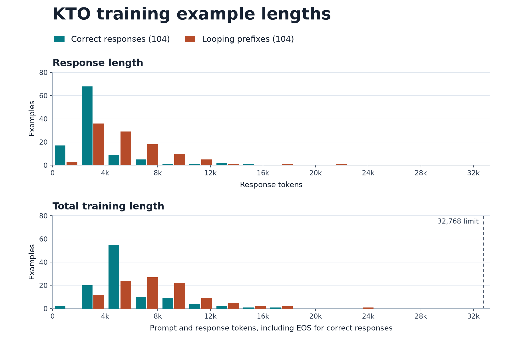

# QAKTO reproducibility

[Back to the QAKTO tutorial](../README.md).

## KTO training

We fine-tuned the QAD baseline in NeMo RL on one four-GPU GB300 node. The parent tutorial saves the checkpoint with eight-way expert parallelism (EP=8), and Megatron redistributes its expert weights when loading at EP=4. Export the trained QAKTO model using the parent’s [NVFP4 export procedure](../../README.md#4-export).

### Collect KTO training responses

Follow these steps to collect a new training set.

1. Use the [44/11 subtask split](data/subtask_split.yaml). Collect responses only for the 44 training subtasks and reserve the other 11 for evaluation.
2. Generate multiple responses per training subtask with the QAD baseline. Keep complete responses that pass the SciCode tests as correct examples.
3. For looping examples, screen generations that reached the 131,072-token output cap without a final answer. Find a paragraph that occurs at least three times, ignoring differences in whitespace. Keep the reasoning through the third occurrence so the training example contains the repetition.
4. Keep each response’s original prompt and remove duplicates. Keep only examples that fit within 32,768 tokens, including the prompt, response, and EOS for correct answers. Select 104 correct responses and 104 looping prefixes.

Follow [training.example.jsonl](data/training.example.jsonl): each row holds correct and looping responses with their own prompts. Prompts end in `<think>\n`; the processor adds EOS only to correct responses.



Median response lengths were 2,957 tokens for correct responses and 4,853 tokens for looping prefixes. The longest training example used 23,852 tokens including its prompt.

### Run KTO training

See [experiment_environment.yaml](../config/experiment_environment.yaml) for the software versions used in training and evaluation. Use [kto.yaml](../config/kto.yaml) to configure KTO training.

On the host, copy the pinned NeMo RL source (revision `19244a094`) from the release image.

```bash
container=$(docker create nvcr.io/nvidia/nemo-rl:v0.7.0)
docker cp "$container:/opt/nemo-rl" ./nemo-rl
docker rm "$container"
```

Mount `./nemo-rl` into `nvcr.io/nvidia/nemo:26.08.00` and set `NEMO_RL_SOURCE` in `run_kto.sh` to the mounted path. The launcher imports NeMo RL and reads `dpo.yaml` from that tree while using the training image’s Megatron Bridge and Core packages.

Set the remaining paths in [run_kto.sh](run_kto.sh). For `PRETRAINED_CHECKPOINT`, use the Megatron QAD iteration directory, such as `iter_0000500`. Keep the model weights, saved ModelOpt quantization state, and original QAD `run_config.yaml` together in that directory. The [Qwen checkpoint helper](../src/qwen36_checkpoint.py) loads the language model and checks that quantization is active.

Run the launcher from the parent tutorial directory.

```bash
bash kto/reproducibility/run_kto.sh
```

On GB300 with NeMo 26.08.00, `run_kto.sh` starts a worker that enables FlashAttention 2 to reduce memory use and splits large FusedAdam groups to avoid running out of tensor handles. The worker leaves both fixes off in NeMo 26.10 RC8. In that version, Transformer Engine can choose fused attention automatically, and FusedAdam splits large updates itself. [Attention fix](../src/sm103_attention.py) · [Optimizer fix](../src/te_optimizer_groups.py)

## Evaluation

We run benchmarks and collect results using the [QAD tutorial’s evaluation setup and configs](../../evaluation/README.md), with presence penalty zero for both models. We compare the models using the paired analysis described in [Evaluating Models Efficiently During Optimization Experiments](https://github.com/NVIDIA/Model-Optimizer/blob/c8559d2b4e547960db1713640d3d54bb9b7c8280/docs/source/announcements/evaluating_models_efficiently_during_optimization_experiments/index.rst).

IFBench and MMMU-Pro used 16 matched launches per model, up from eight in the parent tutorial. Each launch used `num_repeats: 1`. The extra runs made the accuracy comparison more precise and helped us check for regressions.

For tau2-bench Telecom, override `agent_args.presence_penalty` from 1.5 to 0 for both models.
