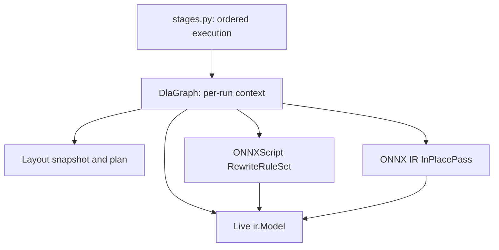

# DLA rules and passes: refactor design

Status: implemented on the local refactor branch, 3 November 2026. This document
records the structural refactor and the subsequent decision to fix pipeline order
and remove the API/CLI transform-selection option. Supported operators and
numerical contracts remain unchanged.
The current implementation remains documented in [README.md](README.md).

## Objective

Make a new transform easy to add: define a named rule with a pattern, eligibility
check and replacement, then register it in its execution phase. Direct IR operations
remain explicit passes. Share per-run graph state without repeating operator
searches or keeping duplicate initializer data.

The current implementation already uses ONNXScript rewriting. The change
moves operator discovery into that matcher and makes rule definitions static,
instead of constructing rules from operators discovered in each model.

## Decisions

- Retain the existing preprocessing, patterns, operators, layout and precision groups.
- Use `rules.py` for fixed `RewriteRuleClassBase` subclasses and `passes.py` for
  operations expressed directly against the IR. Omit unused files.
- Use a small per-run `DlaGraph` wrapper around the existing `ir.Model`.
- Keep the execution order and rule batches explicit in `stages.py`.
- Run every phase in fixed order; only FP16 conversion remains optional.
- Let ONNXScript perform matching, replacement and consumer reconnection. Use its
  existing rule classes and ONNX IR pass interface rather than inventing another.
- Preserve behavior during migration. Algorithm improvements are separate changes.

## Architecture



## Target structure

```text
dla_transforms/
    __init__.py
    context.py          # DlaGraph and phase state
    stages.py           # Ordered rule groups and pass invocations
    common.py           # Small helpers shared across groups
    validation.py       # Input contract
    schemas.py          # ModelProto opset preparation before IR construction
    cleanup.py          # Existing cleanup and initializer deduplication
    preprocessing/
        __init__.py
        rules.py
        passes.py
    patterns/
        __init__.py
        rules.py
    operators/
        __init__.py
        rules.py
    layout/
        __init__.py
        rules.py
        passes.py
    precision/
        __init__.py
        rules.py
        passes.py
```

Each class owns one transformation, even when multiple classes share a module.
Small helpers used only within a group stay private in that group's files.
`__init__.py` contains exports, with no orchestration or transformation bodies.
Keep `cleanup.py` as a root module; no new directory is needed merely for symmetry.
The cleanup module can contain both its fixed rules and direct cleanup passes.

## Per-run graph state

`DlaGraph` uses composition, holding one `ir.Model`. Current tensors and connections
continue to live in that model.

| State | Source and lifetime |
| --- | --- |
| `model` | The live working IR model for this conversion |
| `initializers`, `inputs`, `outputs` | Properties returning the live graph collections |
| Current tensor shapes and types | Read from `ir.Value.shape` and `ir.Value.type` |
| `native_shapes` | Input/output shape tuples keyed by nodes present at layout entry |
| `public_outputs` | Names, shapes and types saved at layout entry |
| `planned_shapes` | Active layout plan, built once and updated only by coordinating layout operations |

Do not copy initializer payloads into a second dictionary. Precision conversion
changes payloads and cleanup removes initializer entries; live properties remain
correct through both operations. Final deduplication stays after precision.

Capture layout state with `begin_layout()` immediately before layout rules run,
after preceding pattern, indexing, recurrent and matrix rewrites. Capturing it in
the wrapper constructor would miss nodes created by those earlier phases.
`native_shapes` and the saved public interface remain unchanged during layout.
`planned_shapes` is a plan, not a history; existing rank-adapter handling sometimes
removes an entry when a public Squeeze already owns the restored output shape.

`end_layout()` releases the layout snapshots before precision conversion. Each
`apply_patterns()` batch captures `batch_nodes` for opt-in original-node guards
and releases that set after SDK execution. The wrapper does not retain every
intermediate model or a history of tensor shapes.
Replacing the entire graph while a layout snapshot is active is outside its pass
contract; a new analysis phase would be required afterward.

## Execution interface

The following is an interface sketch, not the implementation of this refactor:

```python
from onnxscript import ir
from onnxscript.rewriter import pattern


class DlaGraph:
    def __init__(self, model: ir.Model):
        self.model = model
        # Layout state is initialized at layout entry, not here.

    @property
    def initializers(self):
        return self.model.graph.initializers

    def begin_layout(self) -> None:
        ...  # Capture public outputs and run the existing layout snapshot analysis.

    def apply_pattern(self, rule: pattern.RewriteRule) -> int:
        return rule.apply_to_model(self.model)

    def apply_patterns(self, rules: list[pattern.RewriteRule]) -> int:
        return pattern.RewriteRuleSet(rules).apply_to_model(self.model)

    def apply_pass(self, transform: ir.passes.InPlacePass) -> ir.passes.PassResult:
        return transform(self.model)
```

Preserve existing rule batches. `RewriteRuleSet([a, b])` visits nodes and tries its
rules in order; executing all of `a` before all of `b` changes scheduling. The
single-rule convenience method does not replace the batched method everywhere.

A pattern application returns an integer rewrite count. An IR pass returns
`PassResult(model, modified)`, where `modified` is Boolean. Record these separately;
do not add a pass result to a rewrite count. Keep useful operation-specific counts,
such as removed initializers, explicitly on their pass where needed.

Restrict direct passes to the in-place SDK interface initially. Invoke the pass
object, not its `call()` method, so the SDK performs its normal contract checks.
Common infrastructure methods may delegate to passes, but individual operator
implementations do not become methods on the wrapper.

## Fixed pattern definitions

A rule definition contains the SDK's `pattern`, `check` and `rewrite` methods,
corresponding to the target, condition and replacement discussed in this design.
Definitions are static; instances are created for each conversion and receive
that conversion's graph wrapper.

```python
from onnxscript.rewriter import pattern


class GqaLayout(pattern.RewriteRuleClassBase):
    def __init__(self, graph: DlaGraph):
        super().__init__(name="GqaLayout")
        self.graph = graph

    def pattern(self, op, query):
        return op.GroupQueryAttention(
            query,
            _domain="com.microsoft",
            _allow_other_inputs=True,
            _outputs=["output", "present_key", "present_value"],
        )

    def check(self, context, **bindings):
        ...  # Validate this matched node using the shared layout metadata.

    def rewrite(self, op, **bindings):
        ...  # Apply the existing native-input and planned-output adapters.
```

Bind it with `GqaLayout.rule(graph)`. The SDK constructs a fresh instance and binds
its callbacks. A custom constructor must call `super().__init__()`.
Do not use a global rule instance carrying mutable state from a previous model.

### GQA walkthrough

1. The fixed target identifies `com.microsoft::GroupQueryAttention` candidates.
2. `check()` reads the matched node from `context.root`, checks domain version 1
   and the variant's exact output count, and compares its saved native input/output
   shapes with the layout plan.
3. If no adaptation is required, return false without changing the graph.
4. `rewrite()` reshapes changed inputs into the operator's native views, emits GQA
   preserving optional inputs, attributes and declared output arity while using
   adapted data inputs, and restores planned output layouts where necessary.
5. The SDK replaces the matched subgraph and reconnects consumers.

The current GQA-specific `plans[node] = inputs, outputs` table duplicates
`native_shapes[node]`; remove that table and its discovery loop. This does not
remove genuine graph-wide analyses such as layout dependency planning or connected
FP32-region analysis.

### Output variants and repeated matching

The installed SDK fixes a pattern's output count when the rule is constructed,
and the replacement must return that same number of outputs. Declare supported
one-, two- and three-output GQA variants statically, sharing their check/replacement
logic. Variadic Split axes are handled by a direct IR pass so arbitrary output
counts do not require per-model rule factories or artificial arity limits. Their checks enforce exact output arity even if a shorter pattern could
match a node with unused extra outputs. Do not scan each model to decide which
variants to construct.

Newly inserted nodes can be visited again in the same rewrite traversal. A rule's
condition must recognize a completed form or use an appropriate original-node
snapshot. For the migrated native-layout rule, membership in `native_shapes` can
exclude its freshly emitted GQA node without another discovery scan.

This is a rule-specific guard. `apply_pattern()` must not globally reject generated
nodes: later matrix, layout or projection rules intentionally process nodes emitted
by earlier transformations. Nodes created before `begin_layout()` belong to that
layout phase's original snapshot.

## Direct IR passes

Use passes for operations whose work is graph-wide or concerns shared storage and
interfaces: connected type analysis, boundary commit, initializer precision
conversion, deduplication and final graph ordering.

A direct pass derives from `ir.passes.InPlacePass` and implements
`call(model) -> ir.passes.PassResult`. It can receive the graph wrapper in its
constructor when it requires layout metadata. Existing functions may remain private
helpers while a thin SDK pass supplies the execution interface.

An example adapter around the existing deduplication helper is:

```python
class DeduplicateInitializers(ir.passes.InPlacePass):
    def call(self, model):
        self.removed_count = deduplicate_initializers(model)
        return ir.passes.PassResult(model=model, modified=self.removed_count > 0)
```

Retain deduplication's exact dtype/shape/content checks, bounded reads, collision
verification and protection for public-input/public-output initializers.

## Shape and ownership rules

The IR stores current metadata, not its history. Replacement outputs may inherit
matched outputs' metadata; intermediate values are not guaranteed to receive
complete automatic shape inference in our rewrite path.

- Set intermediate shapes/types explicitly where subsequent rules need them.
- Create actual Reshape, Squeeze, Unsqueeze or Cast operations when runtime data
  representation changes. Metadata assignments alone do not perform conversion.
- Preserve public names, shapes and dtypes, including overridable initializers.
- Preserve native controls when the same tensor also feeds promoted data ports.
- Use one initializer creation/naming mechanism, then deduplicate at the end.
- Keep global shape inference at completed graph boundaries, as today.

## Execution order

Use this fixed order:

```text
Validate options and prepare supported ModelProto opset
Initial symbolic shape inference -> IR -> DlaGraph
Preprocessing phase
Connected-pattern phase
Individual-operator phase:
    indexing -> recurrent -> matrix -> remove unused nodes
    begin_layout
    shape -> indexing -> axis -> normalization -> native rule groups
    rank-adapter rules -> boundary commit
    logical rewrites and required consumer conversions
Cleanup of layout chains and permitted identities
Optional FP16 preparation, including its existing late projection rules
Final initializer deduplication -> topological sort
Serialize -> final shape inference and full ONNX checking -> save
```

The API and CLI no longer accept a transform-selection list. Every conversion
runs preprocessing before the connected-pattern and individual-operator phases.
Capture layout metadata after earlier operator lowering. Reorganizing definitions
into `rules.py` does not move when they execute: terminal projection remains late
in optional precision conversion.

`stages.py` registers fixed rule classes in ordered groups and invokes direct
passes between those groups. For example, a native-layout group can construct its
InstanceNormalization and fixed GQA variants with `.rule(graph)` and apply them
in one `apply_patterns()` call.

## Migration map

| Destination | Current responsibilities |
| --- | --- |
| `preprocessing/rules.py` | Q/DQ removal/folding, Constant materialization and Cast rewriting |
| `preprocessing/passes.py` | Connected type-region analysis and coordinated metadata preparation |
| `patterns/rules.py` | Reshape patterns, TopK/Gather and terminal projection definitions |
| `operators/rules.py` | Indexing, MatMul/Gemm, logical and LSTM rule definitions |
| `layout/rules.py` | Shape, indexing, axis, normalization, native and rank-adapter rules |
| `layout/passes.py` | Snapshot/dependency analysis, boundary commit and shared layout metadata |
| `precision/rules.py` | Existing activation Cast rewrite |
| `precision/passes.py` | FP32-region analysis, initializer conversion and precision boundaries |
| Root modules | Keep validation, ModelProto opset preparation, cleanup, orchestration and shared helpers |

Private helpers move with their owning transformation. Avoid public re-exports of
helpers or a second registry that duplicates the execution lists. Keep runtime
imports directed from orchestration toward context/rules/passes; use type-only
context imports where needed to avoid cycles. The wrapper does not discover rule
modules or import a global plugin registry.

## Incremental implementation plan

Each step must work independently, preserve existing outputs, and carry its
necessary test adjustments. Keep review PRs under approximately 500 added source
lines; split the larger milestones by transform family rather than landing the
entire refactor together.

1. **Introduce the wrapper.** Delegate to the current builders/passes; preserve
   snapshots, batch order, public interfaces and final deduplication timing.
2. **Pilot GQA.** Add fixed GQA rule variants in `layout/rules.py`, remove its
   duplicate node-discovery table, and retain the other layout builders temporarily.
3. **Migrate layout families individually.** Convert InstanceNormalization, axes,
   shapes, indexing and normalization; move direct layout operations into
   `layout/passes.py`. Remove each obsolete module when its callers are migrated.
4. **Migrate connected patterns and operators individually.** Keep existing ordering,
   output-arity coverage, tensor sharing and generated-node interactions.
5. **Migrate preprocessing and precision.** Preserve necessary global analyses;
   keep direct operations in passes and fixed operator replacements in rules.
6. **Remove migration adapters.** Reduce package initializers to exports, remove
   dead builder functions/imports, and update the implementation guide to the final
   contract. Transitional interfaces are not permanent alternatives.

The local implementation now follows this structure, and the README describes
its actual interfaces. Before publishing, split the review series by the slices
above to respect the repository's source-line budget; the local branch is not an
already-published stack.

## Adding a transform after migration

1. Choose its execution phase and owning `rules.py` or `passes.py`.
2. Implement one named rule class or direct pass, documenting supported forms.
3. Bind per-run state through the constructor; keep node eligibility in `check()`.
4. Register it in the appropriate ordered group in `stages.py`; do not change the
   wrapper for each new operator. Declare required arity variants explicitly.
5. Extend the owning tests with a real matching case, output checks and any
   meaningful refusal/termination cases; update the supported-scope documentation.

## Validation and completion criteria

- Extend existing fast tests rather than duplicating them for the new classes.
  Test names should follow their new owning `rules.py`/`passes.py` modules after
  migration; SDK-only scaffolding remains outside the committed suite.
- Preserve supported layouts, standard/contrib domains, optional inputs and live
  output variants. Verify that no-op matches leave the graph unchanged.
- Exercise original nodes and later rules consuming generated nodes. A repeated
  same-op rewrite test must fail promptly rather than hang the test runner.
- Check shared initializers, data/control consumers, public endpoints and
  initializer deduplication after FP16 conversion.
- Compare transformed graphs and exact tensor payloads with the current validated
  baseline on the existing local model corpus, in both precision modes. A structural
  refactor must not silently weaken that comparison.
- Run the public [MobileGaze opset-20 example](README.md#public-model-example-mobilegaze-opset-20)
  as an independent smoke check. Keep FP32 equivalence and FP16 numerical behavior
  separate; the refactor is not permission to change either contract.
- Measure CPU time and peak memory on representative large models when a slice
  changes traversal, copying, cached state or initializer handling.
- Run the repository hooks and report environmental limitations explicitly.

Completion means the agreed directories contain fixed rule classes and direct
passes, new rules require definition plus ordered registration, repeated operator
scans/duplicate eligibility tables are gone where matching suffices, and behavior
matches the pre-refactor baseline.

## SDK references

- [ONNXScript pattern rewriting and rule classes](https://microsoft.github.io/onnxscript/tutorial/rewriter/rewrite_patterns.html)
- [RewriteRuleClassBase API](https://microsoft.github.io/onnxscript/api/generated/onnxscript.rewriter.pattern.RewriteRuleClassBase.html)
- [ONNX IR pass infrastructure](https://onnx.ai/ir-py/api/ir_passes.html)
